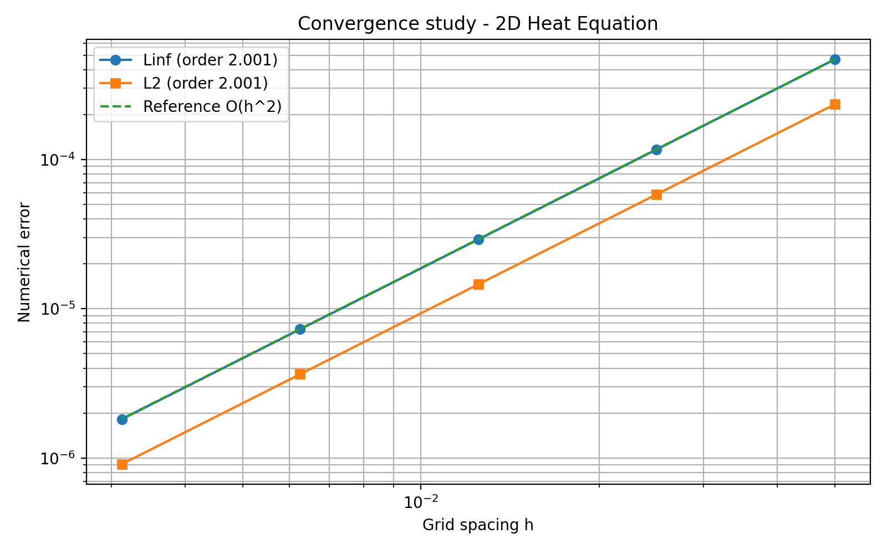
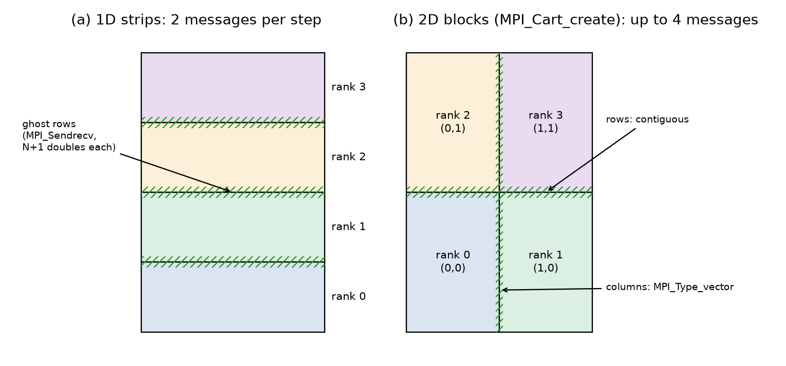
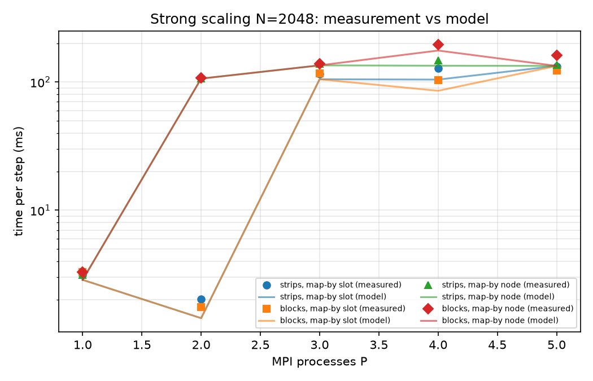

# Parallel 2D Heat Diffusion with MPI over Tailscale — Final Report

**Team:** Jose Azzi, Dia Hajjar, Theresa Kozah  
**Repository:** https://github.com/joseazzi/parallele_programming  
**Detailed write-ups:** `docs/PART0_CLUSTER.md` … `docs/PART4_PERFORMANCE.md`; background-notes solutions in `docs/background/`.

---

## (a) The cluster

### Machines and virtual machines

| | heat-jose | heat-dia-1 | heat-theresa |
|---|---|---|---|
| Host | MacBook Pro, Apple M1 (4P+4E cores), 8 GB, macOS | Intel Core i5-1235U, Windows | Intel Core i7-1255U, Windows |
| Hypervisor | Multipass (QEMU) | Hyper-V | VirtualBox |
| VM architecture | **ARM64** | x86-64 | x86-64 |
| vCPUs / RAM | 2 / 3.8 GiB | 2 / **1.9 GiB** | 2 / 3.8 GiB |
| OS / MPI | Ubuntu 24.04.5, Open MPI 4.1.6 | same | same |
| Tailscale IP | 100.125.52.39 | 100.115.31.27 | 100.100.103.111 |

**Notes on the setup:**

- The cluster mixes architectures, so each VM compiles its own binary
  from the same source at the same path, with
  `-O2 -std=c++17 -ffp-contract=off`.
- Dia's VM has less than the required 4 GB of RAM. This was enough
  for every grid we ran.
- MPI is restricted to the tailnet with
  `--mca oob_tcp_if_include tailscale0 --mca btl_tcp_if_include tailscale0 --mca btl tcp,self`.
- Passwordless SSH works between every pair of VMs, and the hostfile
  is `hosts.example` (2 slots per VM).

### Network

- **Wi-Fi:** all three laptops were on the **same Wi-Fi network**
  for the measurements.
- **Direct connections:** `tailscale ping` reported direct
  connections for every pair, at 57–144 ms.
- **Relays:** at other times traffic went through DERP relays
  (Paris, London). Jose–Theresa then measured 260–320 ms. The Wi-Fi
  probably blocks peer-to-peer traffic intermittently, so the
  connection type changed during the project. Section (d) shows how
  much this matters.

### Latency and bandwidth

The ping-pong program (`pingpong.cpp`) times 8 B to 16 MiB messages.
We fitted t_msg(m) = t_s + m·t_w to the one-way time:

- t_s is the median for small messages;
- t_w comes from a fit to large messages with t_s held fixed
  (`scripts/fit_pingpong_model.py`).

| Connection | Status | t_s | Bandwidth 1/t_w | R² (large m) |
|---|---|---:|---:|---:|
| Jose, same VM | local | 0.19 µs | 36.7 Gbit/s | 0.92 |
| Dia, same VM | local | 0.41 µs | 38.0 Gbit/s | 0.97 |
| Theresa, same VM | local | 0.40 µs | 41.9 Gbit/s | 0.98 |
| Jose–Dia | direct | 32.2 ms | 6.9 Mbit/s | 0.996 |
| Jose–Theresa | direct (DERP seen earlier) | 33.0 ms | 6.4 Mbit/s | 0.997 |
| Dia–Theresa | direct | 39.8 ms | 5.1 Mbit/s | 0.996 |

Across machines, the latency is about **10⁵ times** worse than inside
one VM, and the bandwidth is about **5 000 times** lower. Plots:
`results/pingpong/communication_model_refined.png`,
`plots/pingpong_latency.png`, `plots/pingpong_bandwidth.png`.

---

## (b) Numerical method

We solve u_t = u_xx + u_yy on [0,1]² with α = 1. The grid has N × N
intervals and spacing h = 1/N. The explicit scheme is the background
notes' Task 5.2:

    u_ij^{n+1} = u_ij^n + r ( u_{i+1,j} + u_{i−1,j} + u_{i,j+1} + u_{i,j−1} − 4 u_ij )^n ,   r = Δt / h²

- **Space:** the 5-point stencil is second-order accurate
  (Tasks 3.2 and 3.4).
- **Time:** forward Euler is first-order.
- **Overall:** with r fixed, Δt = O(h²), so the global error is
  O(Δt + h²) = O(h²) (Task 5.5).

**Stability.** The von Neumann analysis (Task 6.3) gives
**0 < r ≤ 1/4**, that is Δt ≤ h²/4. The solver refuses an unstable r
and prints the reason.

When we deliberately ran r = 0.3 (Part 1) or r = 0.2625 (Task 6.7),
a checkerboard mode grew without bound. The maximum |u| reached
6.6 × 10¹¹, against 0.61 for r = 0.2 (`plots/stability.png`,
`plots/background/task_6_7_snapshots.png`).

**Implementation:**

- The grid is one contiguous `std::vector<double>` accessed through a
  single index function.
- There are two time levels, swapped each step rather than copied.
- Only the time-stepping loop is timed, with `MPI_Wtime` or
  `steady_clock`.
- The output file is the raw little-endian (N+1)² field in row-major
  order, followed by one `key=value` summary line on stdout.
- **Interface:** one executable per decomposition (`heat_serial`,
  `heat_strips`, `heat_blocks`). Each takes `--case 1|2|V --N --r
  --T|--steps --out --decomp`; see the README.

**Convergence study** (Task 7.2, Case V, exact solution
sin πx sin πy e^{−2π²t}):

| N | ‖e‖∞ | ‖e‖₂,h | ratio |
|---:|---:|---:|---:|
| 20 | 4.686e-4 | 2.343e-4 | – |
| 40 | 1.167e-4 | 5.837e-5 | 4.01 |
| 80 | 2.916e-5 | 1.458e-5 | 4.00 |
| 160 | 7.289e-6 | 3.644e-6 | 4.00 |
| 320 | 1.822e-6 | 9.110e-7 | 4.00 |

The observed order is **p = 2.001** in both norms, as Task 5.5
predicts (`plots/convergence.png`; background version
`plots/background/task_7_2_convergence.png`).



---

## (c) Parallel decompositions and how we tested them



*Figure 1: (a) 1D strips, (b) 2D blocks. Hatched: ghost layers filled
by halo exchange.*

### 1D strips (`src/parallel/heat_strips.cpp`)

- **Split:** the N−1 interior rows are divided into contiguous
  strips. The first (N−1) mod P ranks get one extra row. Rank 0 owns
  the bottom strip.
- **Ghost rows:** each rank stores n_local + 2 rows of N+1 values; the
  plate boundary acts as the ghost row at either end.
- **Halo exchange:** two `MPI_Sendrecv` calls per step (up, then
  down), each sending one contiguous row of N+1 doubles straight from
  the array. `MPI_PROC_NULL` replaces the missing neighbour, so there
  are no special cases.
- **Timing:** computation and exchange are timed separately and
  reduced with `MPI_Reduce(MPI_MAX)`.
- **Output:** rank 0 assembles the field with `MPI_Gatherv`.

**Deadlock.** Suppose every rank first calls a blocking `MPI_Send`
upward and then `MPI_Recv`. For small messages, Open MPI copies the
data into an internal buffer (the *eager* protocol), so `MPI_Send`
returns and everything works. Above the eager limit (tens of kB over
TCP), `MPI_Send` waits until the matching receive is posted. All
ranks are then stuck in `MPI_Send` and none reaches `MPI_Recv`: a
circular wait, so the program hangs for large N.

`MPI_Sendrecv` posts the send and the receive together, and the
library completes them in an order that cannot cycle. The exchange
therefore never deadlocks, whatever the message size.

### 2D blocks (`src/parallel/heat_blocks.cpp`)

- **Process grid:** `MPI_Dims_create` chooses P_x × P_y, and
  `MPI_Cart_create` (non-periodic) builds the grid.
- **Neighbours:** found with `MPI_Cart_shift`; the plate edges come
  back as `MPI_PROC_NULL`.
- **Split:** rows and columns are divided as evenly as possible.
- **Halo exchange:** rows go as contiguous messages; columns go as an
  `MPI_Type_vector` with stride n_x+2, with no manual packing. Four
  `MPI_Sendrecv` per step.

**Corner ghost values are never exchanged.** The 5-point stencil
reads only the N, S, E and W neighbours, never the diagonals, so
corner ghosts are never used. A **9-point stencil** (for example, the
isotropic Laplacian) would need them.

### Testing

1. **Halo debugging.** Case 2 with N = 8, one step, P = 2 and P = 3
   (uneven strips). We printed every local array, including ghost
   rows, first on one VM and then across Jose, Dia and Theresa.
2. **Bit-for-bit comparison with the serial code** using `cmp`:
   - Strips: P = 1, 2, 3, 4; N = 5, 8, 40, 41 (equal and unequal
     strips); Cases 1, 2 and V. All **identical**.
   - Blocks: Case 2, N = 512, P = 8. **Identical**.
   - Case V: strips and serial report the same ‖e‖∞ = 1.1674e-4 and
     ‖e‖₂ = 5.8370e-5.
3. **Mixed ARM64/x86-64 cluster.** With `-ffp-contract=off`, the P = 2
   (Jose + Dia) and P = 3 (Jose + Dia + Theresa) outputs were
   **identical to serial**, so the largest difference is 0.

Details: `docs/PART2_STRIPS.md` and `docs/PART3_BLOCKS.md`.

---

## (d) Performance results, model, and answers to Parts 3 and 4

### Measurement protocol

- **Run:** Case 2, r = 0.2, 3 repetitions per configuration; we
  report the median (spreads are in the CSV files).
- **Hosts:** one process per vCPU at most; laptops plugged in; all on
  the same Wi-Fi.
- **Scripts:** `scripts/part4_final.sh` (138 successful runs, raw
  output kept in `results/part4/final/`) and
  `scripts/part4_analyze.py`.

**Changes from the suggested protocol:**

- **20 steps instead of 500.** A step across VMs costs about 0.1 s, so
  we compare time *per step*.
- **P ≤ 5.** Two busy ranks on Theresa's 2-vCPU VM (P = 6) repeatedly
  knocked it off the tailnet. Four earlier P = 6 runs succeeded and
  are reported in the Part 4 document.
- **N = 8192 not run**, to save time. The model covers it.

### Single-node baseline (compute rate)

Serial, 500 steps:

| N | Jose ns/node | Dia ns/node | Theresa ns/node | Jose ms/step |
|---:|---:|---:|---:|---:|
| 512 | 0.63 | 0.86 | 1.06 | 0.16 |
| 2048 | 0.68 | 1.78 | 2.45 | 2.87 |
| 8192 | 0.79 | 1.82 | 1.62 | 53.0 |

Jose's ARM64 VM is 2–3.5× faster than the x86-64 VMs, so in any
multi-VM run the slowest rank sets the pace.

### Strong scaling

Time per step in ms. With `--map-by slot`, P = 2 stays on one VM, P = 3–4
use Jose and Dia, and P = 5 adds Theresa. With `--map-by node`, P ≥ 3
uses all three VMs.

| N | Mode | P=1 | P=2 slot | P=2 node | P=3 slot | P=3 node | P=4 slot | P=4 node | P=5 slot | P=5 node |
|---:|---|---:|---:|---:|---:|---:|---:|---:|---:|---:|
| 512 | strips | 0.35 | **0.19** | 87.5 | 94.7 | 109.5 | 96.1 | 103.7 | 142.7 | 113.7 |
| 512 | blocks | 0.36 | **0.16** | 88.7 | 95.7 | 94.7 | 92.1 | 179.1 | 117.9 | 108.1 |
| 2048 | strips | 3.14 | **2.03** | 107.0 | 115.2 | 138.9 | 127.6 | 147.8 | 132.2 | 135.9 |
| 2048 | blocks | 3.30 | **1.75** | 107.3 | 116.8 | 139.1 | 103.1 | 196.1 | 122.4 | 161.3 |

**Speedup and efficiency:**

- **On one VM** (P = 2, slot): S = 1.8–2.2 at N = 512 and 1.5–1.9 at
  N = 2048, so E = 0.77–1.1.
- **As soon as a second VM is involved:** S = 0.002–0.004 at
  N = 512 and 0.017–0.032 at N = 2048. The parallel run is
  **30–500× slower** than serial.

**Communication share:**

| Configuration | Share of time in halo exchange |
|---|---|
| P = 1 | < 0.1 % |
| One VM | 5–12 % |
| Across VMs, N = 512 | 99.8 % |
| Across VMs, N = 2048 | 98–99.6 % |



*Figure 2: time per step at N = 2048, measured (points) vs model (lines).
Also: `plots/part4_strong_N512.png`, `plots/part4_speedup.png`,
`plots/part4_efficiency.png`.*

### Weak scaling

Weak scaling keeps about 1024² nodes per process, with N = 1024·√P and
`--map-by slot`. Measured time per step:

| P | N | Strips (ms) | Blocks (ms) | Machines |
|---:|---:|---:|---:|---|
| 1 | 1024 | 1.15 | 1.10 | Jose |
| 2 | 1448 | 1.14 | 1.08 | Jose |
| 3 | 1774 | 110 | 144 | Jose, Dia |
| 4 | 2048 | 111 | 99 | Jose, Dia |
| 5 | 2290 | 137 | 154 | all three |

Time is constant while the job stays on one VM, which is ideal. It
jumps **about 100×** when the second VM joins and then stays roughly
flat, because the per-step network latency does not grow with N
(`plots/part4_weak.png`).

### Performance model (Section 8.3, from Task 8.2)

    T_step = max_ranks [ c_vm(N) · n_x n_y ]  +  Σ_phases 2 · max_pairs ( t_s + m t_w )

- **c_vm(N):** each VM's measured compute rate.
- **n_x n_y:** the rank's interior nodes.
- **Phases:** one per direction with more than one rank (strips: 1
  direction; blocks: up to 2), each costing two `MPI_Sendrecv` (up
  and down).
- **Pair cost:** each pair uses its own Part 0 values, t_s and t_w,
  for the same VM or for that cross-VM link.
- **m:** 8 × (halo length + 2) bytes.

**How well it fits:**

- Across VMs, the measurements lie between 10 % below and 55 % above
  the model, typically 10–30 % above.
- The model reproduces the main shapes:
  - the ~100× jump when the job leaves one VM;
  - the flat curve afterwards;
  - blocks with `--map-by node` at P = 4 being the slowest
    configuration. With ranks on Jose, Dia, Theresa, Jose in a 2×2
    grid, all four phases cross machines.

### Answers to the Part 3 questions

**Corners.** See (c): the 5-point stencil never reads corner ghosts;
a 9-point stencil would.

**Strips vs blocks at P = 4, 8 and N = 512, 2048, 8192.** Task 8.2's
model with our mean cross-VM t_s = 35 ms and t_w = 1.33 µs/B predicts:

| P | N = 512 | N = 2048 | N = 8192 |
|---|---|---|---|
| 4 | Blocks (75 vs 81 ms) | Blocks (92 vs 114 ms) | Blocks (157 vs 245 ms) |
| 8 | Strips | Strips | Blocks |

For P = 8 the crossover is at N ≈ 4400. Latency dominates, so the
number of messages matters more than their size.

**What we measured on the cluster at P = 4:**

- **`--map-by slot`:** strips 96 vs blocks 92 ms at N = 512, and
  128 vs 103 ms at N = 2048. Blocks are slightly ahead, as predicted.
- **`--map-by node`:** blocks are much slower (179 vs 104 ms and
  196 vs 148 ms). Placement can turn the prediction around, because
  it decides how many messages cross the network.
- **P = 8** cannot be run on our 6 slots. On one VM with
  oversubscription, strips won 3 of 3 sizes, matching the prediction
  for N ≤ 2048 (`docs/PART3_BLOCKS.md`).

### Answers to the Part 4 questions

**For which N does spreading across machines pay off, and does the
model agree?**
It never paid off in our measurements: across VMs, S ≤ 0.03 up to
N = 2048. The model puts the crossover for P = 5 at
**N ≈ 67 000**. Only there does the compute time saved exceed the
~0.1–0.2 s of latency per step. That grid needs about 72 GB, far
beyond our VMs. For N = 8192, the model predicts S₅ ≈ 0.17. Model and
measurement agree: **no crossover on this cluster.**

**Where do model and measurement disagree, and why?**

1. **Relays and Wi-Fi.** Links switch between direct and DERP during
   a run, which adds 20–40 % and widens the spread. For example, one
   set of 3 runs ranged from 2.3 to 8.2 s.
2. **A slow node holds everyone back.** Theresa's VM is the slowest
   compute node, and its links have the highest t_s (39.8 ms), so
   P = 5 is always the slowest slot configuration.
3. **An unstable node.** Theresa's VM dropped off the tailnet four
   times during the campaign. Each time, the run failed and was
   rerun.
4. **Short runs.** With 20 steps, first-touch page faults and a cold
   cache are not amortised. The P = 1 MPI run takes 0.35 ms per step,
   against the serial baseline's 0.16 ms.
5. **Synchronisation and OS noise,** which the model ignores.

**What would change on a real cluster with t_s ≈ 1 µs?**
Using the same model with 10 GB/s:

- Communication falls to about 10 µs per step, below 1 %.
- The crossover drops to **N ≈ 80**.
- S₅ ≈ 2.8 (N = 512), 1.4 (N = 2048) and 2.2 (N = 8192).

The remaining gap to 5 is **load imbalance**: the x86 VMs are 2–3×
slower than Jose's. A weighted decomposition, with rows proportional
to each node's speed, would close most of it.

**Advice for running this over Tailscale.**

- **Don't distribute** unless the grid does not fit on one machine.
- **If you must:**
  - Make sure `tailscale ping` shows a direct connection; use wired
    connections; keep hosts awake with Wi-Fi power saving off.
  - Use `--map-by slot`, so neighbouring ranks share a VM.
  - Prefer **strips** (fewer messages).
  - Use the largest N that fits in memory.
  - Leave a core free for tailscaled and sshd.
  - Reduce the number of latency payments: deeper halos exchanged
    every k steps, or overlapping communication with computation.

Full details: `docs/PART4_PERFORMANCE.md`.

---

## (e) Part 5 (GPU)

Not attempted. None of our VMs can use a GPU: Multipass, Hyper-V and
VirtualBox do not pass one through, and the Mac host has no NVIDIA GPU.

---

## (f) Contributions

The three of us worked on every part of the project **together, in
joint sessions**. All three were present when we designed, coded,
debugged, measured and wrote. Every team member is therefore familiar
with, and responsible for, all of the code, the results and this
report.

Each of us provided and maintained one cluster node:

- **Jose Azzi:** heat-jose (Multipass on an Apple M1 MacBook Pro).
- **Dia Hajjar:** heat-dia-1 (Hyper-V on Windows).
- **Theresa Kozah:** heat-theresa (VirtualBox on Windows).

The author names in the Git history show whose machine or account
was used to commit, not who did the work. For example, most commits
were pushed from Jose's VM, and the background-notes solutions from
Theresa's.

**Use of LLMs:** ChatGPT and Claude Code were used throughout. The
complete conversation logs are submitted separately, as required by
Section 12 of the project statement.

---

## Appendix A — Reproducing the results

```bash
make                                         # heat_serial, heat_strips, heat_blocks, pingpong, hello_mpi
./heat_serial --case V --N 80 --r 0.2 --T 0.05
mpirun --hostfile hosts.example -np 6 \
  --mca oob_tcp_if_include tailscale0 --mca btl_tcp_if_include tailscale0 --mca btl tcp,self \
  ./heat_blocks --case 2 --N 512 --r 0.2 --steps 500 --decomp blocks --out u.bin
bash scripts/part4_final.sh                  # Part 4 measurement campaign
python3 scripts/part4_analyze.py             # tables, model, figures
```

## Appendix B — Where the data is

| Topic | Files |
|---|---|
| Cluster, ping-pong | `docs/PART0_CLUSTER.md`, `pingpong_*.csv`, `results/pingpong/` |
| Serial, convergence, stability | `docs/PART1_SERIAL.md`, `results/convergence.csv`, `plots/convergence.png`, `plots/stability.png` |
| Strips, blocks, correctness | `docs/PART2_STRIPS.md`, `docs/PART3_BLOCKS.md`, `results/cluster/` |
| Performance | `docs/PART4_PERFORMANCE.md`, `results/part4/`, `plots/part4_*.png` |
| Background notes | `docs/background/chapter1–8.md`, `results/background/`, `plots/background/` |
