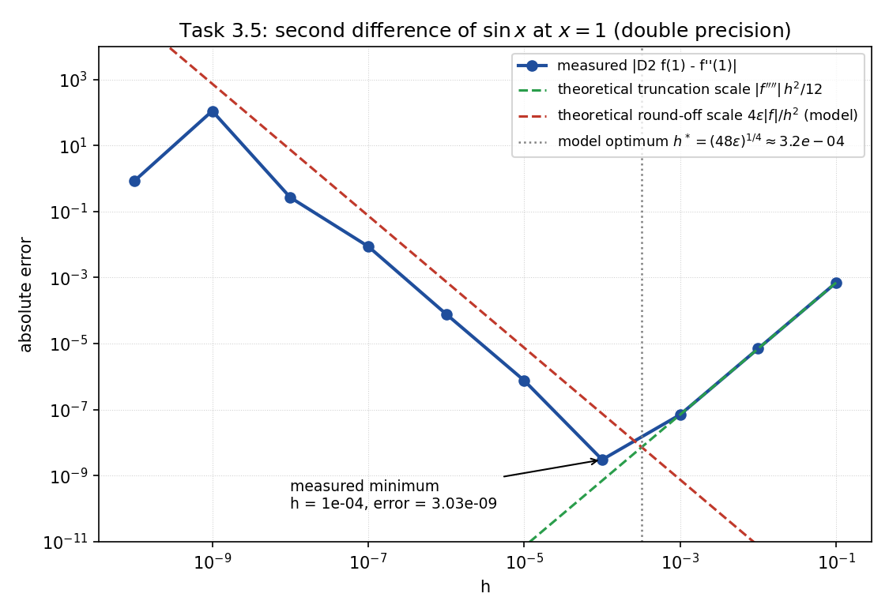

# Chapter 3 - Discretizing Space: Finite Differences

## Task 3.1 - The backward difference

### Objective

Determine the truncation error of the backward
difference approximation and its order of accuracy.

### Given formula

$$
D_-f(x)=\frac{f(x)-f(x-h)}{h}
$$

### Step 1 - Taylor expansion

Using the result from Task 2.1(b):

$$
f(x-h)=f(x)-hf'(x)
+\frac{h^2}{2}f''(x)
-\frac{h^3}{6}f'''(x)
+\frac{h^4}{24}f^{(4)}(x)
+O(h^5)
$$

### Step 2 - Substitute into the backward difference

$$
D_-f(x)=\frac{1}{h}
\left[
f(x)-f(x)+hf'(x)
-\frac{h^2}{2}f''(x)
+\frac{h^3}{6}f'''(x)
-\frac{h^4}{24}f^{(4)}(x)
+O(h^5)
\right]
$$

Canceling f(x) and dividing by h gives:

$$
D_-f(x)=f'(x)
-\frac{h}{2}f''(x)
+\frac{h^2}{6}f'''(x)
-\frac{h^3}{24}f^{(4)}(x)
+O(h^4)
$$

### Step 3 - Calculate the truncation error

Using the definition of truncation error:

$$
\tau(h)=D_-f(x)-f'(x)
$$

Therefore:

$$
\tau(h)=
-\frac{h}{2}f''(x)
+\frac{h^2}{6}f'''(x)
-\frac{h^3}{24}f^{(4)}(x)
+O(h^4)
$$

The leading error term is:

$$
\boxed{
\tau(h)=-\frac{h}{2}f''(x)+O(h^2)
}
$$

### Step 4 - Determine the order of accuracy

The leading error is proportional to h.

Therefore:

$$
\boxed{\tau(h)=O(h)}
$$

The backward difference is first-order accurate.

When h is divided by two, the leading truncation
error is approximately divided by two, provided
the leading coefficient is nonzero.

### Comparison with other finite differences

| Method | Order of accuracy |
|---|---|
| Forward difference | O(h) |
| Backward difference | O(h) |
| Central difference | O(h^2) |

The backward and forward differences have the
same order of accuracy, but their leading
truncation errors have opposite signs.

### Conclusion

The backward difference approximates the first
derivative using the current point and the
previous point.

Its truncation error decreases linearly with h,
making it a first-order approximation.

## Task 3.2 - A finite difference for f''

### (a) Derivation of the second derivative

Using the Taylor expansions from Task 2.1:

$$
f(x+h)=f(x)+hf'(x)
+\frac{h^2}{2}f''(x)
+\frac{h^3}{6}f'''(x)
+\frac{h^4}{24}f^{(4)}(x)
+O(h^5)
$$

$$
f(x-h)=f(x)-hf'(x)
+\frac{h^2}{2}f''(x)
-\frac{h^3}{6}f'''(x)
+\frac{h^4}{24}f^{(4)}(x)
+O(h^5)
$$

Adding both expansions cancels the odd-order terms:

$$
f(x+h)+f(x-h)
=2f(x)+h^2f''(x)
+\frac{h^4}{12}f^{(4)}(x)
+O(h^5)
$$

Subtracting 2f(x):

$$
f(x+h)-2f(x)+f(x-h)
=h^2f''(x)
+\frac{h^4}{12}f^{(4)}(x)
+O(h^5)
$$

Dividing by h squared:

$$
\frac{f(x+h)-2f(x)+f(x-h)}{h^2}
=f''(x)+\frac{h^2}{12}f^{(4)}(x)
+O(h^3)
$$

Therefore, the second derivative approximation is:

$$
\boxed{
D_2f(x)=
\frac{f(x+h)-2f(x)+f(x-h)}{h^2}
}
$$

### (b) Truncation error and accuracy

The truncation error is defined as:

$$
\tau(h)=D_2f(x)-f''(x)
$$

Using the previous derivation:

$$
\tau(h)=\frac{h^2}{12}f^{(4)}(x)
+O(h^3)
$$

For a sufficiently smooth function, the fifth-order
Taylor terms also cancel by symmetry.

Therefore, the sharper expression is:

$$
\boxed{
\tau(h)=\frac{h^2}{12}f^{(4)}(x)
+O(h^4)
}
$$

The leading error is proportional to h squared.

$$
\boxed{\tau(h)=O(h^2)}
$$

The approximation is second-order accurate.

When h is divided by two, the error is expected
to decrease by approximately a factor of four.

### (c) Numerical verification

Consider:

$$
f(x)=\sin(x)
$$

The exact second derivative is:

$$
f''(x)=-\sin(x)
$$

At x=1 radian:

$$
f''(1)=-\sin(1)
\approx-0.841470984808
$$

The numerical approximation is:

$$
D_2f(1)=
\frac{\sin(1+h)-2\sin(1)+\sin(1-h)}
{h^2}
$$

The absolute error is:

$$
E(h)=|D_2f(1)-f''(1)|
$$

The error reduction ratio is:

$$
R=\frac{E(h)}{E(h/2)}
$$

The observed convergence order is:

$$
p_{\mathrm{obs}}=\log_2(R)
$$

The theoretical predictions are:

- Error reduction ratio approaches 4.
- Observed convergence order approaches 2.

The existing numerical experiment implemented
by Jose is reused from:

src/task_3_2.py

### Application to the project

This approximation is used to discretize the
second spatial derivatives in the heat equation.

It forms the basis of the five-point stencil
implemented in our serial, strips and blocks solvers.

The existing solver implementation and previous
numerical experiment are preserved.

### Recorded numerical results for Task 3.2(c)

The existing script src/task_3_2.py was executed
on Theresa's Ubuntu VM.

The exact second derivative at x=1 is:

$$
f''(1)=-0.841470984808
$$

| h | Approximation | Absolute error | Error ratio | Observed order |
|---:|---:|---:|---:|---:|
| 0.2 | -0.838669818726 | 2.801166081798e-03 | - | - |
| 0.1 | -0.840769992687 | 7.009921204787e-04 | 3.996002 | 1.998557 |
| 0.05 | -0.841295692961 | 1.752918469772e-04 | 3.999000 | 1.999639 |
| 0.025 | -0.841427159107 | 4.382570074124e-05 | 3.999750 | 1.999910 |

### Interpretation of results

As h decreases, the numerical approximation
approaches the exact second derivative.

Every time h is divided by two, the absolute
error decreases by approximately a factor of four.

The observed error ratios approach 4:

$$
R\rightarrow4
$$

The observed convergence orders approach 2:

$$
p_{\mathrm{obs}}\rightarrow2
$$

These experimental results confirm the theoretical
second-order accuracy derived in Task 3.2(b).

### Conclusion

Both the mathematical derivation and the numerical
experiment support:

$$
\boxed{D_2f(x)-f''(x)=O(h^2)}
$$

### Repository files

- Existing script: src/task_3_2.py
- Raw results: results/background/task_3_2.csv
- Analyzed results: results/background/task_3_2_analysis.csv

Jose's original Python script was reused without
modification. Only the missing written derivation,
numerical results and convergence analysis were added.

## Task 3.3 - Sanity checks on the second derivative

### (a) Verification using simple functions

The second derivative approximation derived
in Task 3.2 is:

$$
D_2f(x)=
\frac{f(x-h)-2f(x)+f(x+h)}{h^2}
$$

#### Case 1 - Constant function f(x)=1

The exact second derivative is:

$$
f''(x)=0
$$

Substituting into the numerical formula:

$$
D_2f(x)=\frac{1-2(1)+1}{h^2}
$$

$$
D_2f(x)=\frac{0}{h^2}
$$

Therefore:

$$
\boxed{D_2f(x)=0}
$$

The numerical approximation is exact.

#### Case 2 - Linear function f(x)=x

The exact second derivative is:

$$
f''(x)=0
$$

Substituting into the numerical formula:

$$
D_2f(x)=
\frac{(x-h)-2x+(x+h)}{h^2}
$$

Simplifying:

$$
D_2f(x)=
\frac{x-h-2x+x+h}{h^2}
=\frac{0}{h^2}
$$

Therefore:

$$
\boxed{D_2f(x)=0}
$$

The numerical approximation is exact.

#### Case 3 - Quadratic function f(x)=x^2

The exact second derivative is:

$$
f'(x)=2x,\qquad f''(x)=2
$$

Substituting into the numerical formula:

$$
D_2f(x)=
\frac{(x-h)^2-2x^2+(x+h)^2}{h^2}
$$

Expanding the squared terms:

$$
(x-h)^2=x^2-2xh+h^2
$$

$$
(x+h)^2=x^2+2xh+h^2
$$

Therefore:

$$
D_2f(x)=
\frac{x^2-2xh+h^2-2x^2+x^2+2xh+h^2}{h^2}
$$

Canceling the opposite terms:

$$
D_2f(x)=\frac{2h^2}{h^2}
$$

Therefore:

$$
\boxed{D_2f(x)=2}
$$

The numerical approximation is exact.

### Summary of results

| Function | Exact second derivative | Numerical result | Error |
|---|---:|---:|---:|
| f(x)=1 | 0 | 0 | 0 |
| f(x)=x | 0 | 0 | 0 |
| f(x)=x^2 | 2 | 2 | 0 |

These results hold for any nonzero h in exact
arithmetic.

A reasonable second derivative approximation
should reproduce these elementary polynomial
derivatives exactly.

Constant and linear functions have zero curvature,
while a quadratic function has constant curvature.

These tests verify that the formula reproduces
the fundamental behavior of the second derivative.

### (b) Sum of the coefficients

The coefficients in the numerator are:

$$
1,\quad -2,\quad 1
$$

Their sum is:

$$
1-2+1=0
$$

Including the denominator:

$$
\frac{1}{h^2}-\frac{2}{h^2}
+\frac{1}{h^2}=0
$$

Therefore:

$$
\boxed{\text{Sum of coefficients}=0}
$$

This is necessary because the second derivative
of a constant function is zero.

It also means that adding a constant to every
function value does not change the approximation
of its second derivative.

### (c) Physical interpretation

The original formula is:

$$
D_2f(x)=
\frac{f(x-h)-2f(x)+f(x+h)}{h^2}
$$

Define the average of the two neighboring values:

$$
A=\frac{f(x-h)+f(x+h)}{2}
$$

Rearranging the second derivative formula gives:

$$
\boxed{
D_2f(x)=\frac{2}{h^2}
\left(A-f(x)\right)
}
$$

Therefore, the second derivative measures the
difference between the average of the neighboring
values and the central value.

- If A > f(x), the second derivative is positive.
- If A < f(x), the second derivative is negative.
- If A = f(x), the second derivative is zero.

### Application to heat diffusion

When the neighboring temperatures are warmer
than the central temperature, the contribution
to the temperature change is positive.

When the neighboring temperatures are colder,
the contribution is negative.

When their average equals the central temperature,
the contribution is zero.

In two dimensions, the same principle applies
to the four neighbors through the discrete
Laplacian.

This interpretation agrees with the mean-value
formula established in Task 1.1.


## Task 3.4 - The discrete Laplacian

### Existing project work

The square-grid discrete Laplacian is already
documented in Section 3.1 of docs/PART1_SERIAL.md.

This section extends the existing derivation
to unequal grid spacing and completes the
additional requirements of Task 3.4.

### (a) Second partial derivative with respect to x

Consider a two-dimensional grid:

$$
x_i=i\Delta x,\qquad y_j=j\Delta y
$$

The temperature at a grid node is denoted by:

$$
u_{i,j}=u(x_i,y_j)
$$

Keeping y fixed, apply the second derivative
formula derived in Task 3.2:

$$
\boxed{
\frac{\partial^2u}{\partial x^2}(x_i,y_j)
\approx
\frac{u_{i+1,j}-2u_{i,j}+u_{i-1,j}}
{(\Delta x)^2}
}
$$

The leading truncation error is:

$$
\tau_x=
\frac{(\Delta x)^2}{12}
\frac{\partial^4u}{\partial x^4}
+O((\Delta x)^4)
$$

Therefore, the approximation is second-order
accurate in the x-direction.

### (b) Second partial derivative with respect to y

Keeping x fixed, the same approximation gives:

$$
\boxed{
\frac{\partial^2u}{\partial y^2}(x_i,y_j)
\approx
\frac{u_{i,j+1}-2u_{i,j}+u_{i,j-1}}
{(\Delta y)^2}
}
$$

The leading truncation error is:

$$
\tau_y=
\frac{(\Delta y)^2}{12}
\frac{\partial^4u}{\partial y^4}
+O((\Delta y)^4)
$$

Therefore, the approximation is second-order
accurate in the y-direction.

### (c) General discrete Laplacian

The continuous two-dimensional Laplacian is:

$$
\nabla^2u=
\frac{\partial^2u}{\partial x^2}
+
\frac{\partial^2u}{\partial y^2}
$$

Adding the approximations from parts (a) and (b):

$$
\boxed{
\nabla_h^2u_{i,j}
=
\frac{u_{i+1,j}-2u_{i,j}+u_{i-1,j}}
{(\Delta x)^2}
+
\frac{u_{i,j+1}-2u_{i,j}+u_{i,j-1}}
{(\Delta y)^2}
}
$$

The total truncation error is:

$$
\tau=\tau_x+\tau_y
$$

Therefore:

$$
\tau=
\frac{(\Delta x)^2}{12}
\frac{\partial^4u}{\partial x^4}
+
\frac{(\Delta y)^2}{12}
\frac{\partial^4u}{\partial y^4}
+
O((\Delta x)^4+(\Delta y)^4)
$$

For a sufficiently smooth function:

$$
\boxed{
\tau=O((\Delta x)^2+(\Delta y)^2)
}
$$

The discrete Laplacian is second-order accurate
in both spatial directions.

### (d) Simplification for equal grid spacing

For a uniform square grid:

$$
\Delta x=\Delta y=h
$$

Substituting into the general formula:

$$
\nabla_h^2u_{i,j}
=
\frac{u_{i+1,j}-2u_{i,j}+u_{i-1,j}}{h^2}
+
\frac{u_{i,j+1}-2u_{i,j}+u_{i,j-1}}{h^2}
$$

Combining the numerators gives:

$$
\boxed{
\nabla_h^2u_{i,j}
=
\frac{
u_{i+1,j}+u_{i-1,j}
+u_{i,j+1}+u_{i,j-1}
-4u_{i,j}
}{h^2}
}
$$

The corresponding truncation error is:

$$
\tau=
\frac{h^2}{12}
\left(
\frac{\partial^4u}{\partial x^4}
+
\frac{\partial^4u}{\partial y^4}
\right)
+O(h^4)
$$

Hence:

$$
\boxed{\tau=O(h^2)}
$$

This is the same discrete Laplacian already
documented in docs/PART1_SERIAL.md and used
by the project solvers.

### (e) Five-point stencil

The discrete Laplacian uses five grid nodes:

- Central node: u(i,j)
- West neighbor: u(i-1,j)
- East neighbor: u(i+1,j)
- South neighbor: u(i,j-1)
- North neighbor: u(i,j+1)

For a general rectangular grid, their weights are:

| Node | Weight |
|---|---|
| West | 1/(dx^2) |
| East | 1/(dx^2) |
| South | 1/(dy^2) |
| North | 1/(dy^2) |
| Center | -2/(dx^2)-2/(dy^2) |

For a square grid, the stencil is:

```
     o---------N---------o
     |         |         |
     |       1/h^2       |
     |         |         |
     W---------C---------E
   1/h^2    -4/h^2     1/h^2
     |         |         |
     |       1/h^2       |
     |         |         |
     o---------S---------o
```

Here C is the highlighted central node.

N, S, E and W are the four neighbors used
in the calculation.

The diagonal nodes are not used.

The stencil can also be represented as:

$$
\frac{1}{h^2}
\begin{bmatrix}
0 & 1 & 0\\
1 & -4 & 1\\
0 & 1 & 0
\end{bmatrix}
$$

The sum of the stencil coefficients is:

$$
1+1+1+1-4=0
$$

Consequently, the discrete Laplacian of a
constant temperature field is zero.

### (f) Comparison with the mean-value formula

Define the average of the four neighboring
temperatures:

$$
A_{i,j}
=
\frac{
u_{i+1,j}+u_{i-1,j}
+u_{i,j+1}+u_{i,j-1}
}{4}
$$

Substituting into the square-grid Laplacian:

$$
\nabla_h^2u_{i,j}
=
\frac{4A_{i,j}-4u_{i,j}}{h^2}
$$

Factoring out 4:

$$
\boxed{
\nabla_h^2u_{i,j}
=
\frac{4}{h^2}
(A_{i,j}-u_{i,j})
}
$$

The discrete Laplacian measures the difference
between the average temperature of the four
neighbors and the central temperature.

- If the neighboring average is greater than
  the central value, the Laplacian is positive.

- If the neighboring average is smaller than
  the central value, the Laplacian is negative.

- If both values are equal, the Laplacian is zero.

The continuous mean-value formula from Section
1.4 relates the circular average around a point
to the Laplacian:

$$
A_h-u=\frac{h^2}{4}\nabla^2u+O(h^4)
$$

Rearranging gives:

$$
\nabla^2u=
\frac{4}{h^2}(A_h-u)+O(h^2)
$$

The continuous circular average and the discrete
four-neighbor average are different averages,
but both express the same local behavior
to second-order accuracy.

### Application to heat diffusion

The heat equation is:

$$
\frac{\partial u}{\partial t}
=\alpha\nabla^2u
$$

Since thermal diffusivity is positive, the sign
of the Laplacian determines whether the local
temperature increases or decreases.

Heat diffusion therefore tends to reduce
temperature differences between neighboring
grid nodes.

### Conclusion

The discrete Laplacian:

- Supports general rectangular grid spacing.
- Is second-order accurate in space.
- Uses a five-point stencil.
- Reproduces constant temperature fields exactly.
- Agrees with the continuous mean-value
  interpretation.

The existing square-grid solver implementation
is preserved without modification.

## Task 3.5 - Where does round-off take over?

Reference: `heat_numerics_background.pdf`, Section 3.8 "A warning about
round-off", PDF page 15, printed page 11.

### Objective

Repeat the numerical experiment of Task 3.2(c) for

$$
h = 10^{-1}, 10^{-2}, \dots, 10^{-10},
$$

plot the error on log-log axes, find roughly where the error stops
decreasing, and explain that value with the competition between
truncation error and floating-point round-off.

### Experiment

Same setting as Task 3.2(c):

$$
D_2f(x)=\frac{f(x+h)-2f(x)+f(x-h)}{h^2},
\qquad f(x)=\sin x,\qquad x=1,
$$

$$
f''(1)=-\sin 1=-0.841470984807897.
$$

Computed in IEEE double precision (Python `float`), with

$$
\varepsilon = 2^{-52} \approx 2.220446\times10^{-16}.
$$

Script: `scripts/background/task_3_5.py` (run on `heat-theresa`).
Raw output: `results/background/task_3_5.csv`.

### Error model (derivation)

**Truncation part.** From Task 3.2(b),

$$
D_2f(x)-f''(x)=\frac{h^2}{12}f^{(4)}(x)+O(h^4),
$$

so the truncation error is about

$$
E_{\mathrm{trunc}}(h)\approx\frac{|f^{(4)}(x)|}{12}\,h^2 .
$$

**Round-off part.** The computer does not use the exact values
$f(x\pm h)$, $f(x)$. Each stored value is
$\tilde f = f(1+\delta)$ with $|\delta|\lesssim\varepsilon$. So the
numerator

$$
\tilde f(x+h)-2\tilde f(x)+\tilde f(x-h)
$$

differs from the exact one by at most about

$$
(|1|+|-2|+|1|)\,\varepsilon|f(x)| = 4\varepsilon|f(x)|.
$$

The numerator itself is tiny (it is about $h^2f''(x)$), so this absolute
error does **not** shrink with $h$. Dividing by $h^2$ amplifies it:

$$
E_{\mathrm{round}}(h)\approx\frac{4\varepsilon|f(x)|}{h^2}.
$$

**Total.** With $a=|f^{(4)}(x)|/12$ and $b=4\varepsilon|f(x)|$:

$$
E(h)\approx a\,h^2+\frac{b}{h^2}.
$$

**Optimal h.** Set the derivative to zero:

$$
E'(h)=2ah-\frac{2b}{h^3}=0
\;\Longrightarrow\;
h^4=\frac{b}{a}
\;\Longrightarrow\;
h^*=\left(\frac{48\,\varepsilon\,|f(x)|}{|f^{(4)}(x)|}\right)^{1/4}.
$$

For $f=\sin$, $f^{(4)}=\sin=f$, so the ratio $|f|/|f^{(4)}|$ equals 1:

$$
h^*=(48\varepsilon)^{1/4}=(1.0658\times10^{-14})^{1/4}\approx3.21\times10^{-4}.
$$

At $h^*$ both terms are equal, and the minimum error is

$$
E^*=2\sqrt{ab}
=2\sqrt{\frac{\sin 1}{12}\cdot4\varepsilon\sin 1}
\approx1.45\times10^{-8}.
$$

**Order-of-magnitude form.** Ignoring constants, $h^2\sim\varepsilon/h^2$
gives $h^4\sim\varepsilon$, so $h\sim\varepsilon^{1/4}\approx1.2\times10^{-4}$.
Compare the first-derivative case in Section 3.8. There the round-off is
divided by $h$, not $h^2$, and the balance $h\sim\varepsilon/h$ gives
$h\sim\sqrt\varepsilon\approx10^{-8}$. Dividing by $h^2$ makes round-off
take over much earlier, at a $h$ about $10^4$ times larger.

### Measured results (actual run)

| h | $D_2f(1)$ computed | absolute error | truncation scale $h^2\sin1/12$ | round-off scale $4\varepsilon\sin1/h^2$ |
|---:|---:|---:|---:|---:|
| 1e-01 | -0.840769992687418 | 7.009921e-04 | 7.0123e-04 | 7.4738e-14 |
| 1e-02 | -0.841463972572898 | 7.012235e-06 | 7.0123e-06 | 7.4738e-12 |
| 1e-03 | -0.841470914725306 | 7.008259e-08 | 7.0123e-08 | 7.4738e-10 |
| **1e-04** | **-0.841470981782777** | **3.025119e-09** | 7.0123e-10 | 7.4738e-08 |
| 1e-05 | -0.841470226831120 | 7.579768e-07 | 7.0123e-12 | 7.4738e-06 |
| 1e-06 | -0.841549052665869 | 7.806786e-05 | 7.0123e-14 | 7.4738e-04 |
| 1e-07 | -0.832667268468868 | 8.803716e-03 | 7.0123e-16 | 7.4738e-02 |
| 1e-08 | -1.110223024625156 | 2.687520e-01 | 7.0123e-18 | 7.4738e+00 |
| 1e-09 | 111.022302462515640 | 1.118638e+02 | 7.0123e-20 | 7.4738e+02 |
| 1e-10 | 0.000000000000000 | 8.414710e-01 | 7.0123e-22 | 7.4738e+04 |

The last two columns are **theoretical scales**, not measurements. The
round-off column is an upper-bound estimate, not a measured round-off error.

Consistency check: the row $h=10^{-1}$ gives the same error
($7.009921\times10^{-4}$) as Task 3.2(c).

- Measured optimal $h$: $10^{-4}$
- Measured minimum error: $3.03\times10^{-9}$
- Model optimum: $h^*\approx3.2\times10^{-4}$, $E^*\approx1.4\times10^{-8}$

### Graph



File: `plots/background/task_3_5_roundoff.png`, produced by
`scripts/background/task_3_5_plot.py` from the CSV above. Both axes are
logarithmic. The solid blue curve is the measured error. The dashed green
and red lines are the theoretical truncation and round-off scales. The
dotted vertical line is the model optimum $h^*$.

### Analysis

**1. Truncation regime ($10^{-1}\ge h\ge10^{-3}$).** Each tenfold
reduction of $h$ divides the error by 100:

$$
\frac{7.009921\times10^{-4}}{7.012235\times10^{-6}}=99.97,
\qquad
\frac{7.012235\times10^{-6}}{7.008259\times10^{-8}}=100.06 .
$$

Observed order: $\log_{10}(100)=2.00$. The measured errors match
$h^2\sin1/12$ to 3-4 significant digits, so round-off is negligible here.
This is the second-order behaviour proved in Task 3.2.

**2. Where the error stops decreasing: $h\approx10^{-4}$.** Going from
$10^{-3}$ to $10^{-4}$, truncation predicts $7.0\times10^{-10}$, but the
measurement is $3.0\times10^{-9}$, already 4 times larger. Round-off now
dominates. Going further to $10^{-5}$, the error **increases** to
$7.6\times10^{-7}$. So the minimum lies between $10^{-4}$ and $10^{-3}$, as
the model predicts with $h^*\approx3.2\times10^{-4}$. Of the ten tested
values, the best is $h=10^{-4}$.

**3. Round-off regime ($10^{-5}\ge h\ge10^{-8}$).** The error grows
roughly as $h^{-2}$:

$$
\frac{7.806786\times10^{-5}}{7.579768\times10^{-7}}=103,
\qquad
\frac{8.803716\times10^{-3}}{7.806786\times10^{-5}}=113 .
$$

That is a slope close to $-2$, as predicted by $4\varepsilon|f|/h^2$. The
measured values sit about one order of magnitude below the red line. That
is expected: the red line is a worst-case bound, where every rounding error
has the maximal size $\varepsilon$ and they all add with the same sign.
Real rounding errors are usually smaller and partly cancel.

**4. Complete breakdown ($h\le10^{-8}$).** The true numerator
$h^2f''(1)\approx-0.84h^2$ is then smaller than $1.1\times10^{-16}$. That
is the spacing between neighbouring double-precision numbers near
$\sin1\approx0.84$ (one ulp $=2^{-53}\approx1.11\times10^{-16}$). So the
computed numerator can only be $0$ or $\pm$ one ulp:

- $h=10^{-8}$: numerator $=-1.110223\times10^{-16}$ (one ulp), so
  $D_2f=-1.110223$, which is meaningless.
- $h=10^{-9}$: numerator $=+1.110223\times10^{-16}$, so $D_2f=+111.02$, with
  the wrong sign and an error of about $10^2$.
- $h=10^{-10}$: the three values cancel exactly, so the numerator is $0$,
  giving $D_2f=0$ and an error of $|f''(1)|=0.841$.

The error at $10^{-10}$ is *smaller* than at $10^{-9}$. So the error does
not grow monotonically in this regime. The result is pure rounding noise
and contains no information about $f''$ at all.

### Answer to the question

The error stops decreasing at about **$h\approx10^{-4}$**. The measured
minimum is $3.0\times10^{-9}$ at $h=10^{-4}$, and the model optimum is
$h^*=(48\varepsilon)^{1/4}\approx3.2\times10^{-4}$. The reason: truncation
error falls like $h^2$, but the rounding errors of the three function
values ($\sim\varepsilon$) are divided by $h^2$ and grow like
$\varepsilon/h^2$. They balance when $h^4\sim\varepsilon$, that is,
$h\sim\varepsilon^{1/4}\approx10^{-4}$. Below that, smaller $h$ only makes
the result worse.

### Relevance to the project

The heat solver does not compute $\nabla_h^2u$ by dividing by $h^2$ in
isolation. The explicit update

$$
u^{n+1}_{i,j}=u^n_{i,j}+r\,(u^n_{i+1,j}+u^n_{i-1,j}+u^n_{i,j+1}+u^n_{i,j-1}-4u^n_{i,j}),
\qquad r=\frac{\alpha\Delta t}{h^2},
$$

multiplies the stencil by $\Delta t/h^2=r\le1/4$. The $1/h^2$ amplification
therefore never occurs, and each step adds a rounding error of only about
$\varepsilon|u|$.

Even if these errors added with no cancellation, the Task 7.2 run at
$N=256$, $T=0.05$, $r=0.2$ takes $T/(rh^2)=16384$ steps. That gives at most
about $16384\,\varepsilon\approx4\times10^{-12}$, far below the
discretization errors ($\sim10^{-6}$ to $10^{-4}$) seen in the convergence
study. As Section 3.8 says, the project is far from this regime.

### Repository files

- `scripts/background/task_3_5.py`: experiment (standard library only)
- `results/background/task_3_5.csv`: measured results
- `scripts/background/task_3_5_plot.py`: plotting script (matplotlib)
- `plots/background/task_3_5_roundoff.png`: log-log graph

Note: matplotlib is not installed on the `heat-theresa` VM. The PNG was
generated by running `task_3_5_plot.py` on the CSV produced on the VM
(matplotlib 3.7.5, Python 3.8 on the host laptop).
