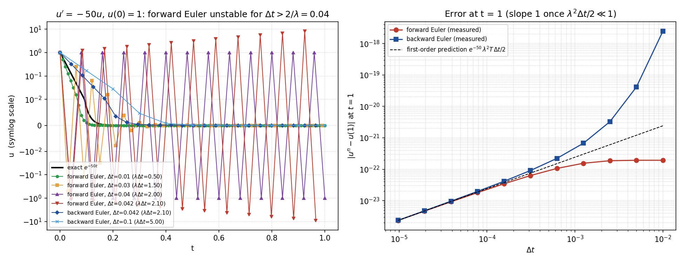

# Chapter 4 - Discretizing Time: Methods for ODEs

## Task 4.1 - Experiments with forward Euler

Reference: `heat_numerics_background.pdf`, Section 4.5, Task 4.1,
PDF page 18, printed page 14.

Test problem:

$$
u'(t)=-\lambda u(t),\qquad u(0)=1,\qquad \lambda=50,\qquad t\in[0,1],
$$

with exact solution $u(t)=e^{-50t}$, so $u(1)=e^{-50}=1.928750\times10^{-22}$.

Files:

- `scripts/background/task_4_1.py`: experiment (standard library only, run on `heat-theresa`)
- `results/background/task_4_1_stability_scan.csv`: parts (b) and (d)
- `results/background/task_4_1_convergence.csv`: part (c)
- `results/background/task_4_1_trajectories.csv`: data for the figure
- `scripts/background/task_4_1_plot.py` → `plots/background/task_4_1_euler.png`

### (a) Implementation

Forward Euler (Worked Example 4.1) with $f(t,u)=-\lambda u$:

$$
u^{n+1}=u^n+\Delta t\,(-\lambda u^n)=(1-\lambda\Delta t)\,u^n .
$$

This is the linear recurrence of Section 2.5, with amplification factor

$$
g_{FE}=1-\lambda\Delta t,\qquad u^n=g_{FE}^{\,n}.
$$

The script applies the update literally, step by step: `u = u - LAM*dt*u`.

### (b) Largest stable time step

**Theory.** $|u^n|=|g_{FE}|^n$ stays bounded if and only if
$|1-\lambda\Delta t|\le1$, that is,

$$
-1\le1-\lambda\Delta t\le1
\iff 0\le\lambda\Delta t\le2
\iff \Delta t\le\frac{2}{\lambda}=\frac{2}{50}=0.04 .
$$

**Experiment.** $\Delta t$ was scanned from $0.0300$ to $0.0500$ in
steps of $0.0005$, plus $0.06, 0.08, 0.1, 0.2, 0.5, 1.0$. Each run was
classified by $|u|$ after 2000 steps: if $|u|\le|u(0)|=1$ it is bounded,
otherwise it blows up. The value at the last step with $t\le1$ is also
recorded. Selected rows of the measured scan:

| $\Delta t$ | $\lambda\Delta t$ | $g_{FE}$ | FE $\lvert u\rvert$ at last $t\le1$ | FE $\lvert u\rvert$ after 2000 steps | FE |
|---:|---:|---:|---:|---:|---|
| 0.0300 | 1.500 | -0.5000 | 1.1642e-10 | 4.9e-324 (underflow) | bounded |
| 0.0350 | 1.750 | -0.7500 | 3.1748e-04 | 1.3259e-250 | bounded |
| 0.0390 | 1.950 | -0.9500 | 2.7739e-01 | 2.8003e-45 | bounded |
| 0.0395 | 1.975 | -0.9750 | 5.3103e-01 | 1.0215e-22 | bounded |
| **0.0400** | **2.000** | **-1.0000** | **1.0000e+00** | **1.0000e+00** | **bounded (neutral)** |
| 0.0405 | 2.025 | -1.0250 | 1.8087e+00 | 2.8037e+21 | BLOWS UP |
| 0.0420 | 2.100 | -1.1000 | 8.9543e+00 | 6.1006e+82 | BLOWS UP |
| 0.0450 | 2.250 | -1.2500 | 1.3553e+02 | 6.6073e+193 | BLOWS UP |
| 0.0500 | 2.500 | -1.5000 | 3.3253e+03 | overflow (nan) | BLOWS UP |
| 0.1000 | 5.000 | -4.0000 | 1.0486e+06 | overflow (nan) | BLOWS UP |

**Measured largest stable $\Delta t$: 0.0400**, exactly the theoretical
value $2/\lambda$.

Checks against the closed form $|u^n|=|g|^n$:

- $\Delta t=0.0400$: $g=-1$, so $u^n=(-1)^n$. The solution neither decays
  nor grows; it flips between $+1$ and $-1$ forever. It is bounded, but
  completely wrong (the exact solution decays to $10^{-22}$).
- $\Delta t=0.0405$: on $[0,1]$ there are $\lfloor1/0.0405\rfloor=24$
  steps, so $|u|=1.025^{24}=1.809$ (measured $1.8087$). After 2000 steps,
  $1.025^{2000}=e^{2000\ln1.025}=e^{49.39}=2.80\times10^{21}$ (measured
  $2.8037\times10^{21}$).
- Only $0.5\%$ above the limit, the solution already grows: the boundary
  between stable and unstable is sharp.

The three regimes of Section 4.3 are all visible:

- $0<\lambda\Delta t\le1$ (e.g. $\Delta t=0.01$): monotone decay.
- $1<\lambda\Delta t<2$ (e.g. $0.03$, $g=-0.5$): decay with a sign flip
  every step.
- $\lambda\Delta t>2$: oscillating growth.

### (c) First-order convergence at t = 1

Runs use $\Delta t=1/n$ with $n=100\cdot2^k$, so that $t=1$ is reached
exactly. The error is $E(\Delta t)=|u^n-e^{-50}|$, with
$p_{obs}=\log_2\big(E(\Delta t)/E(\Delta t/2)\big)$.

| n | $\Delta t$ | FE $u^n$ | FE abs error | FE rel error | ratio | $p_{obs}$ |
|---:|---:|---:|---:|---:|---:|---:|
| 100 | 1.0000e-02 | 7.888609e-31 | 1.9287e-22 | 1.0000 | — | — |
| 200 | 5.0000e-03 | 1.028615e-25 | 1.9277e-22 | 0.99947 | 1.001 | 0.001 |
| 400 | 2.5000e-03 | 6.356546e-24 | 1.8652e-22 | 0.96704 | 1.034 | 0.048 |
| 800 | 1.2500e-03 | 3.775906e-23 | 1.5512e-22 | 0.80423 | 1.202 | 0.266 |
| 1600 | 6.2500e-04 | 8.684500e-23 | 1.0603e-22 | 0.54973 | 1.463 | 0.549 |
| 3200 | 3.1250e-04 | 1.299695e-22 | 6.2905e-23 | 0.32615 | 1.686 | 0.753 |
| 6400 | 1.5625e-04 | 1.584924e-22 | 3.4383e-23 | 0.17826 | 1.830 | 0.872 |
| 12800 | 7.8125e-05 | 1.748854e-22 | 1.7990e-23 | 0.093271 | 1.911 | 0.935 |
| 25600 | 3.9063e-05 | 1.836718e-22 | 9.2032e-24 | 0.047716 | 1.955 | 0.967 |
| 51200 | 1.9531e-05 | 1.882201e-22 | 4.6548e-24 | 0.024134 | 1.977 | 0.983 |
| 102400 | 9.7656e-06 | 1.905341e-22 | 2.3409e-24 | 0.012137 | 1.989 | **0.992** |

The ratio tends to $2=2^1$ and $p_{obs}\to1$: **forward Euler is first
order**. The convergence only becomes visible for small $\Delta t$. This
is explained exactly by the closed form.

**Error formula.** With $n=T/\Delta t$ and $\ln(1-x)=-x-x^2/2-x^3/3-\dots$:

$$
\ln u^n=n\ln(1-\lambda\Delta t)
=-\lambda T-\frac{\lambda^2T}{2}\Delta t-\frac{\lambda^3T}{3}\Delta t^2-\dots
$$

Therefore

$$
\frac{u^n}{u(T)}=\exp\!\Big(-\frac{\lambda^2T}{2}\Delta t+O(\Delta t^2)\Big),
\qquad
\frac{|u^n-u(T)|}{u(T)}\approx\frac{\lambda^2T}{2}\Delta t=1250\,\Delta t
\quad\text{when }1250\,\Delta t\ll1 .
$$

- The global error is proportional to $\Delta t$, which proves first order.
- The constant $\lambda^2T/2=1250$ is large because $\lambda$ is large. The
  asymptotic regime requires $\Delta t\ll1/1250=8\times10^{-4}$, which is
  why $p_{obs}$ only approaches 1 for $n\gtrsim10^4$.
- Check at $n=102400$: $1250\Delta t=0.012207$. With the second-order
  correction, $1-e^{-0.012207}=0.012133$; measured $0.012137$.
- For $n=100$ ($\lambda\Delta t=0.5$): $u^n=0.5^{100}=7.9\times10^{-31}$,
  while $u(1)=1.9\times10^{-22}$. The numerical solution has decayed far
  too fast, the relative error is 100 %, and no order can be observed.

The absolute errors are tiny ($10^{-22}$) only because $u(1)$ itself is
tiny. The relative error is the meaningful measure, and the ratios are
identical for both.

### (d) Backward Euler

$$
u^{n+1}=u^n+\Delta t\,(-\lambda u^{n+1})
\;\Longrightarrow\;
(1+\lambda\Delta t)\,u^{n+1}=u^n
\;\Longrightarrow\;
u^{n+1}=\frac{u^n}{1+\lambda\Delta t},
\qquad g_{BE}=\frac{1}{1+\lambda\Delta t}.
$$

For a scalar equation the "implicit solve" is a single division.

**Repeating (b):** backward Euler stayed bounded for **all 47** scanned
time steps, up to $\Delta t=1.0$ ($\lambda\Delta t=50$). There is no
largest stable time step. Examples from the scan:

| $\Delta t$ | $g_{BE}$ | BE $\lvert u\rvert$ at last $t\le1$ | FE at same $\Delta t$ |
|---:|---:|---:|---|
| 0.0400 | 0.3333 | 1.1802e-12 | neutral, $\pm1$ |
| 0.0420 | 0.3226 | 4.9967e-12 | blows up |
| 0.1000 | 0.1667 | 1.6538e-08 | blows up |
| 0.5000 | 0.0385 | 1.4793e-03 | blows up |
| 1.0000 | 0.0196 | 1.9608e-02 | blows up |

**Observations.**

1. $0<g_{BE}<1$ for every $\Delta t>0$. The numerical solution is always
   positive and decays monotonically, like the exact one: the method is
   **unconditionally stable**, with no oscillation and no blow-up.
2. Stable does not mean accurate. At $\Delta t=1$ a single step gives
   $u=1/51=0.0196$, while the truth is $1.9\times10^{-22}$. Large steps
   give a qualitatively right but quantitatively poor answer.
3. Accuracy is still first order. By the same series argument,
   $\ln u^n=-n\ln(1+\lambda\Delta t)=-\lambda T+\frac{\lambda^2T}{2}\Delta t-\dots$,
   so the relative error is again $\approx1250\,\Delta t$, this time an
   overestimate. Measured: $0.012278$ at $n=102400$, with $p_{obs}=1.008$
   (see `task_4_1_convergence.csv`).

### Graph

Left: trajectories on a symmetric-log axis.

- Forward Euler at $\Delta t=0.01$ decays monotonically.
- At $0.03$ it oscillates but decays.
- At $0.04$ it flips between $\pm1$ indefinitely.
- At $0.042$ it oscillates with growing amplitude.
- Backward Euler at $0.042$ and $0.1$ decays smoothly.

Right: measured error at $t=1$ against $\Delta t$ (log-log). Both methods
approach the slope-1 prediction $e^{-50}\lambda^2T\Delta t/2$ (dashed,
theoretical) as $\Delta t\to0$.

### Conclusion and link to the heat equation

- Forward Euler on $u'=-\lambda u$ is stable if and only if
  $\Delta t\le2/\lambda$. This was confirmed experimentally, with the
  largest stable $\Delta t=0.0400=2/50$.
- It is first-order accurate ($p_{obs}=0.992$), but only once
  $\lambda^2T\Delta t/2\ll1$.
- Backward Euler is stable for every $\Delta t$ at the price of an
  implicit solve, and is also first order.
- For the heat equation, Section 4.4 and Theorem 4.2 apply with
  $\lambda\to\mu_{\max}$, the largest eigenvalue of the discrete Laplacian.
  Since $\mu_{\max}\propto1/h^2$, the restriction $\Delta t\le2/\mu_{\max}$
  becomes $\Delta t=O(h^2)$, which is derived precisely in Chapter 6.
