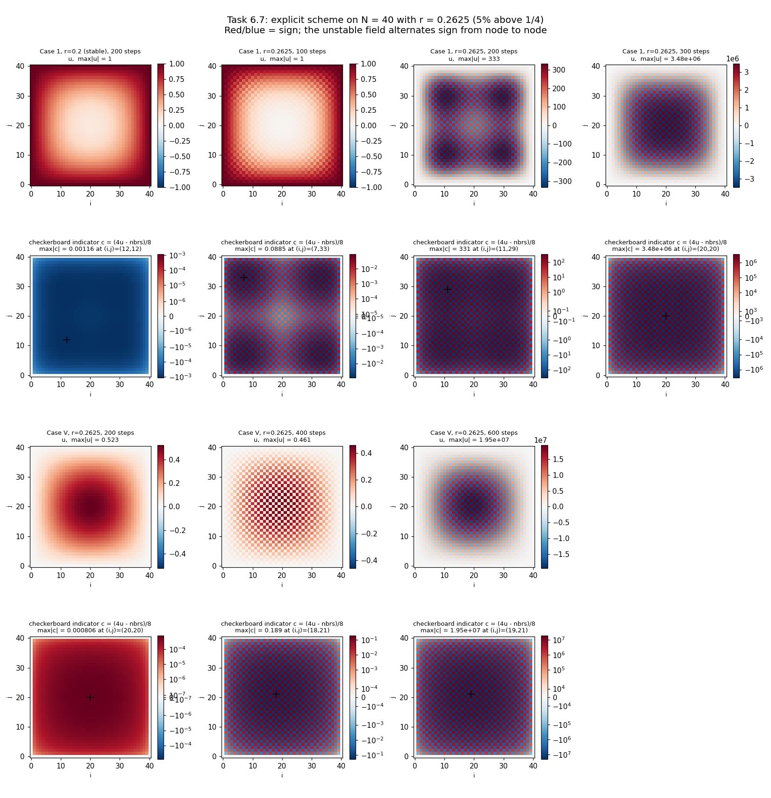
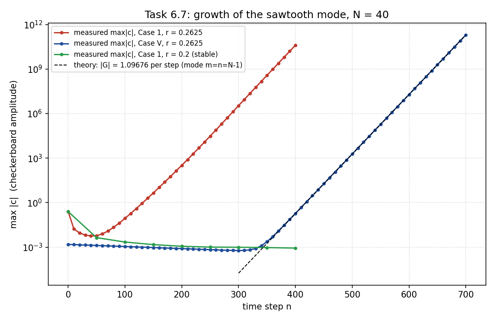

# Chapter 6 - Stability and Convergence

Reference: `heat_numerics_background.pdf`, Chapter 6, PDF pages 22-25,
printed pages 18-21.

Mandatory tasks: 6.1, 6.2, 6.3, 6.4, 6.6, 6.7. The optional Task 6.5 is
also solved.

Notation: $s=\alpha\Delta t/\Delta x^2$ (1D), $r_x=\alpha\Delta t/\Delta x^2$,
$r_y=\alpha\Delta t/\Delta y^2$, and $r=\alpha\Delta t/h^2$ when
$\Delta x=\Delta y=h$ (Chapter 5). The symbol $\mathrm i=\sqrt{-1}$; spatial
indices are $j,k$, as in the PDF.

---

## Task 6.1 - Verify the upwind computation

Upwind scheme (Worked Example 6.4): $u_j^{n+1}=u_j^n-\nu(u_j^n-u_{j-1}^n)$.
Substituting $u_j^n=G^ne^{\mathrm ij\theta}$ and dividing by $G^ne^{\mathrm ij\theta}$:

$$
G=1-\nu+\nu e^{-\mathrm i\theta},\qquad
\overline G=1-\nu+\nu e^{\mathrm i\theta}.
$$

Expand $|G|^2=G\overline G$:

$$
\begin{aligned}
G\overline G
&=(1-\nu)^2+(1-\nu)\nu\,e^{\mathrm i\theta}+(1-\nu)\nu\,e^{-\mathrm i\theta}+\nu^2e^{-\mathrm i\theta}e^{\mathrm i\theta}\\
&=(1-\nu)^2+\nu^2+\nu(1-\nu)\left(e^{\mathrm i\theta}+e^{-\mathrm i\theta}\right)\\
&=1-2\nu+2\nu^2+2\nu(1-\nu)\cos\theta
&&\text{(Theorem 2.3: }e^{\mathrm i\theta}+e^{-\mathrm i\theta}=2\cos\theta)\\
&=1-2\nu(1-\nu)+2\nu(1-\nu)\cos\theta\\
&=1-2\nu(1-\nu)\,(1-\cos\theta)\\
&=1-4\nu(1-\nu)\sin^2(\theta/2)
&&\text{(using }1-\cos\theta=2\sin^2(\theta/2)).
\end{aligned}
$$

This is the result quoted in Example 6.4. Since $\sin^2(\theta/2)\in[0,1]$,
$|G|\le1$ for all $\theta$ if and only if $\nu(1-\nu)\ge0$, i.e.
$0\le\nu\le1$ (the CFL condition).

Check of the worst mode $\theta=\pi$: $G=1-\nu+\nu e^{-\mathrm i\pi}=1-2\nu$,
so $|G|^2=(1-2\nu)^2=1-4\nu+4\nu^2=1-4\nu(1-\nu)$. This agrees with the
formula.

---

## Task 6.2 - Von Neumann analysis in 1D

Scheme from Task 5.1: $u_j^{n+1}=u_j^n+s\,(u_{j+1}^n-2u_j^n+u_{j-1}^n)$.

### (a) Amplification factor

Substitute $u_j^n=G^ne^{\mathrm ij\theta}$. Then $u_{j\pm1}^n=e^{\pm\mathrm i\theta}u_j^n$
and $u_j^{n+1}=Gu_j^n$. Dividing by $G^ne^{\mathrm ij\theta}$:

$$
G(\theta)=1+s\left(e^{\mathrm i\theta}-2+e^{-\mathrm i\theta}\right)
=\boxed{\,1-4s\sin^2(\theta/2)\,}
$$

using identity (2.1). It is real because the stencil is symmetric: the
$e^{\pm\mathrm i\theta}$ terms appear with equal weights, so their imaginary
parts $\pm\sin\theta$ cancel. Physically, diffusion damps modes but does
not move them.

### (b) Worst mode

As $\theta$ varies, $\sin^2(\theta/2)$ runs over $[0,1]$, so
$G\in[1-4s,\,1]$.

- $G\le1$ always.
- $|G|$ is largest at the lower end, where $\sin^2(\theta/2)=1$, i.e.
  $\theta=\pm\pi$, giving $G(\pi)=1-4s$.

The mode $\theta=\pi$ is $u_j=e^{\mathrm ij\pi}=(-1)^j$: the **sawtooth**
$+1,-1,+1,-1,\dots$, the most oscillatory pattern the grid can
represent (wavelength $2\Delta x$).

### (c) Stability condition

$$
|G|\le1\ \forall\theta
\iff 1-4s\ge-1
\iff s\le\frac12
\iff \boxed{\,\Delta t\le\frac{\Delta x^2}{2\alpha}\,}
$$

---

## Task 6.3 - Von Neumann analysis in 2D

Scheme from Task 5.2(a), with $u_{j,k}^n=G^ne^{\mathrm i(j\theta+k\varphi)}$
($j$ indexes $x$, $k$ indexes $y$).

### (a) Amplification factor

Shifts in $j$ give $e^{\pm\mathrm i\theta}$ and shifts in $k$ give
$e^{\pm\mathrm i\varphi}$:

$$
G=1+r_x\left(e^{\mathrm i\theta}-2+e^{-\mathrm i\theta}\right)+r_y\left(e^{\mathrm i\varphi}-2+e^{-\mathrm i\varphi}\right)
=\boxed{\,1-4r_x\sin^2\frac{\theta}{2}-4r_y\sin^2\frac{\varphi}{2}\,}
$$

It is again real, and $G\le1$.

### (b) Worst mode and condition for general $\Delta x$, $\Delta y$

$G$ is smallest (most negative) when both sines are 1, i.e.
$\theta=\varphi=\pi$:

$$
G(\pi,\pi)=1-4r_x-4r_y,\qquad u_{j,k}=(-1)^{j+k}.
$$

This is the **checkerboard**: every node has the opposite sign to all four
of its neighbours. Stability requires

$$
1-4(r_x+r_y)\ge-1\iff r_x+r_y\le\frac12\iff
\alpha\Delta t\left(\frac1{\Delta x^2}+\frac1{\Delta y^2}\right)\le\frac12,
$$

$$
\boxed{\,\Delta t\le\frac{1}{2\alpha}\left(\frac1{\Delta x^2}+\frac1{\Delta y^2}\right)^{-1}
=\frac{\Delta x^2\Delta y^2}{2\alpha(\Delta x^2+\Delta y^2)}\,}
$$

### (c) Equal spacing

With $r_x=r_y=r$: $2r\le\frac12$, so

$$
\boxed{\,r=\frac{\alpha\Delta t}{h^2}\le\frac14\,},\qquad\Delta t\le\frac{h^2}{4\alpha}.
$$

This is the bound enforced by `src/heat_serial.cpp`, which rejects
`r > 0.25`. The project value $r=0.2$ satisfies it.

**Remark (Dirichlet boundaries).** On the bounded grid with zero boundary
values, the admissible modes are $\sin(m\pi x_j)\sin(n\pi y_k)$ with
$1\le m,n\le N-1$, i.e. $\theta=m\pi/N$. The worst one, $m=n=N-1$, has

$$
G=1-8r\cos^2\!\left(\frac{\pi}{2N}\right),
$$

which is slightly less negative than $1-8r$. The condition is therefore
marginally weaker on a finite grid, and tends to $r\le1/4$ as
$N\to\infty$. This exact value is the one checked against the experiment
in Task 6.7.

### (d) Comparison with 1D, and 3D

| dimension | condition on $r=\alpha\Delta t/h^2$ | max $\Delta t$ |
|---|---|---|
| 1D | $r\le1/2$ | $h^2/(2\alpha)$ |
| 2D | $r\le1/4$ | $h^2/(4\alpha)$ |
| 3D (guess, then verified) | $r\le1/6$ | $h^2/(6\alpha)$ |

The 2D bound is **half** the 1D bound. Each dimension adds a term
$-4r\sin^2(\cdot/2)$ to $G$. In $d$ dimensions the checkerboard gives
$G=1-4dr$, and $1-4dr\ge-1$ gives $r\le\frac1{2d}$. For 3D,
$G=1-4r(\sin^2\frac\theta2+\sin^2\frac\varphi2+\sin^2\frac\psi2)$, so
$r\le1/6$, and in general $\alpha\Delta t\left(\Delta x^{-2}+\Delta y^{-2}+\Delta z^{-2}\right)\le\frac12$.
The centre weight $1-2dr$ has to stay above $-1$ while more neighbours
pull on it.

---

## Task 6.4 - Positivity of the weights

From Task 5.3: $w_0=1-4r$ and $w_E=w_W=w_N=w_S=r$, with $\sum w=1$.

The neighbour weights are $r>0$ automatically. The only condition is

$$
w_0=1-4r\ge0\iff\boxed{\,r\le\frac14\,}
$$

For general spacing, $w_0=1-2r_x-2r_y\ge0\iff r_x+r_y\le\frac12$.

**Comparison with Task 6.3.** This is exactly the von Neumann condition,
both for equal and for general spacing. When it holds, every new value is
a convex combination of old values, so

$$
\min_{\text{stencil}}u^n\le u_{i,j}^{n+1}\le\max_{\text{stencil}}u^n .
$$

This is the discrete maximum principle, which gives stability in the
maximum norm. Von Neumann's analysis gives the same bound in the $\ell^2$
norm. For this scheme, the two views agree exactly.

**Physically, when the condition is violated** ($w_0<0$):

- The node's own old temperature enters with a negative weight. Take a hot
  spot $u=1$ surrounded by $u=0$. Then $u^{n+1}=1-4r<0$: in one step the
  spot gives away more heat than it had relative to its neighbours, and
  becomes colder than anything in the plate. This is physically impossible
  for pure diffusion.
- At $r=0.2625$: $w_0=-0.05$. The spot goes from $1$ to $-0.05$, and each
  neighbour receives $0.2625$.
- Next step the now-cold node overshoots in the other direction. The sign
  flips every step, and nodes flip opposite to their neighbours. This is
  the checkerboard mode $(-1)^{i+j}$ of Task 6.3, with $|G|=4r\cdot2-1>1$,
  growing each step.
- The overshoot creates new extrema, so the maximum principle fails. In
  Task 6.7, Case 1 values exceed the boundary maximum 1 after about 120
  steps ($\max|u|=1.09$).

---

## Task 6.5 - Eigenvalues of the discrete second derivative (optional)

Reference: Section 6.5, PDF pages 24-25, printed pages 20-21.

Setting: 1D, $x_i=i\Delta x$, $\Delta x=L/N$, with $u_0=u_N=0$. From Task
5.1(a), the interior values $\mathbf u=(u_1,\dots,u_{N-1})^T$ satisfy
$\mathbf u'=-A\mathbf u$ with

$$
(A\mathbf u)_i=\frac{\alpha}{\Delta x^2}\left(2u_i-u_{i+1}-u_{i-1}\right),
\qquad
A=\frac{\alpha}{\Delta x^2}
\begin{bmatrix}
2&-1&&\\
-1&2&\ddots&\\
&\ddots&\ddots&-1\\
&&-1&2
\end{bmatrix}\in\mathbb R^{(N-1)\times(N-1)} .
$$

$A$ is symmetric. It is the matrix of Section 4.4.

### (a) Eigenvectors and eigenvalues

Let $v_i=\sin(m\pi x_i/L)=\sin(i\,\phi)$ with $\phi=m\pi\Delta x/L=m\pi/N$,
$m=1,\dots,N-1$.

**Neighbour sum.** By $\sin(a+b)+\sin(a-b)=2\sin a\cos b$:

$$
v_{i+1}+v_{i-1}=\sin((i+1)\phi)+\sin((i-1)\phi)=2\cos\phi\,\sin(i\phi)=2\cos\phi\;v_i .
$$

**Ends of the vector.** The rows $i=1$ and $i=N-1$ of $A$ omit $u_0$ and
$u_N$ (they are zero). The formula still holds there, because the sine
vanishes at the walls: $v_0=\sin0=0$ and $v_N=\sin(m\pi)=0$. So the same
expression is valid for every row $1\le i\le N-1$:

$$
(A\mathbf v)_i=\frac{\alpha}{\Delta x^2}\left(2-2\cos\phi\right)v_i
=\frac{4\alpha}{\Delta x^2}\sin^2\frac{\phi}{2}\;v_i
\qquad(1-\cos\phi=2\sin^2\tfrac\phi2).
$$

Hence $\mathbf v^{(m)}$ is an eigenvector (it is nonzero for
$1\le m\le N-1$), with eigenvalue

$$
\boxed{\ \mu_m=\frac{4\alpha}{\Delta x^2}\sin^2\!\left(\frac{m\pi\Delta x}{2L}\right)
=\frac{4\alpha}{\Delta x^2}\sin^2\!\left(\frac{m\pi}{2N}\right),\qquad m=1,\dots,N-1\ }
$$

These are $N-1$ distinct values, because $\sin^2$ is increasing on
$(0,\pi/2)$. So they are all the eigenvalues of the
$(N-1)\times(N-1)$ matrix $A$, and all of them are positive.

**Numerical check** (`scripts/background/task_6_5.py`, run on
`heat-theresa`). For every $m=1,\dots,N-1$ the script applies $A$ to
$\mathbf v^{(m)}$ and measures $\max_i|(A\mathbf v)_i-\mu_mv_i|/\mu_m$:

| N | worst relative residual over all m |
|---:|---:|
| 10 | 2.5e-15 |
| 40 | 1.3e-13 |
| 160 | 2.2e-12 |

These are round-off level, which confirms the eigenpairs.

### (b) Largest eigenvalue

$\sin^2(m\pi/2N)$ is largest for $m=N-1$:

$$
\mu_{\max}=\frac{4\alpha}{\Delta x^2}\sin^2\!\left(\frac{(N-1)\pi}{2N}\right)
=\frac{4\alpha}{\Delta x^2}\cos^2\!\left(\frac{\pi}{2N}\right)
=\frac{4\alpha}{\Delta x^2}\cos^2\!\left(\frac{\pi\Delta x}{2L}\right).
$$

Since $\cos^2(\pi\Delta x/2L)\to1$ as $\Delta x\to0$,

$$
\boxed{\ \mu_{\max}\sim\frac{4\alpha}{\Delta x^2}\ }
\qquad\text{i.e. }\mu_{\max}\Delta x^2\to4\alpha:\ \text{it grows like }1/\Delta x^2 .
$$

Measured values ($\alpha=L=1$):

| N | $\mu_{\max}$ | $\mu_{\max}\Delta x^2$ |
|---:|---:|---:|
| 10 | 3.902113e+02 | 3.902113 |
| 40 | 6.390135e+03 | 3.993835 |
| 160 | 1.023901e+05 | 3.999614 |
| 640 | 1.638390e+06 | 3.999976 |

Each time $N$ is multiplied by 4, $\mu_{\max}$ is multiplied by about 16.

### (c) Forward Euler stability via Theorem 4.2

Theorem 4.2 states that forward Euler on $\mathbf u'=-A\mathbf u$ is
stable if and only if $\Delta t\le2/\mu_{\max}$:

$$
\Delta t\le\frac{2}{\mu_{\max}}=\frac{\Delta x^2}{2\alpha\cos^2(\pi\Delta x/2L)} .
$$

Since $\cos^2(\cdot)\le1$, the condition $\Delta t\le\frac{\Delta x^2}{2\alpha}$,
i.e. $s=\alpha\Delta t/\Delta x^2\le\frac12$, guarantees stability for
**every** $N$. As $\Delta x\to0$, the exact bound tends to exactly this
value:

| N | $2/\mu_{\max}$ | $\Delta x^2/(2\alpha)$ | largest stable $s$ |
|---:|---:|---:|---:|
| 10 | 5.125428e-03 | 5.000000e-03 | 0.512543 |
| 40 | 3.129824e-04 | 3.125000e-04 | 0.500772 |
| 160 | 1.953313e-05 | 1.953125e-05 | 0.500048 |
| 640 | 1.220710e-06 | 1.220703e-06 | 0.500003 |

**Comparison with Task 6.2.** Von Neumann gave $s\le\frac12$, the same
condition. The two views agree even mode by mode. Forward Euler multiplies
the coefficient of $\mathbf v^{(m)}$ by

$$
1-\mu_m\Delta t=1-4s\sin^2\!\left(\frac{m\pi}{2N}\right)=G(\theta_m),
\qquad\theta_m=\frac{m\pi}{N},
$$

which is exactly the von Neumann factor $G(\theta)=1-4s\sin^2(\theta/2)$
of Task 6.2, evaluated at the wavenumbers allowed by the Dirichlet
boundaries. The slightly larger bound on a finite grid appears because the
worst wavenumber $\theta=\pi$ (sawtooth) is not exactly available. The
closest one is $\theta_{N-1}=\pi(N-1)/N$. This is the 1D version of the
Remark in Task 6.3(c), and the 2D analogue was confirmed experimentally in
Task 6.7.

### (d) Small m: comparison with the exact decay rate

In Section 1.8 (1D version), the mode $\sin(m\pi x/L)$ decays like
$e^{-\lambda_mt}$ with $\lambda_m=\alpha(m\pi/L)^2$. For small
$\phi=m\pi\Delta x/L$, use $\sin z=z-z^3/6+\dots$, so
$\sin^2z=z^2-z^4/3+\dots$ with $z=\phi/2$:

$$
\mu_m=\frac{4\alpha}{\Delta x^2}\left[\frac{\phi^2}{4}-\frac{\phi^4}{48}+O(\phi^6)\right]
=\alpha\left(\frac{m\pi}{L}\right)^2\left[1-\frac{1}{12}\left(\frac{m\pi\Delta x}{L}\right)^2+O(\Delta x^4)\right].
$$

$$
\boxed{\ \frac{\mu_m}{\lambda_m}=1-\frac{(m\pi\Delta x/L)^2}{12}+O(\Delta x^4)\ }
$$

- For fixed $m$, $\mu_m\to\lambda_m$ with a relative error
  $O(\Delta x^2)$. That is the second-order accuracy of $D_2$ found in
  Task 3.2: the factor $\frac1{12}$ is the same $\frac{h^2}{12}f^{(4)}$
  coefficient, since $f^{(4)}=(m\pi/L)^4f$ for this sine.
- The semi-discrete system decays every smooth mode at almost the right
  rate.
- For large $m$ (comparable to $N$), the agreement breaks down. The grid
  cannot resolve modes with only a few points per wavelength. The highest
  mode has $\mu_{N-1}/\lambda_{N-1}\to4/\pi^2\approx0.405$. The discrete
  operator damps it too slowly, but it is also the mode that limits
  $\Delta t$ (part c).

Measured with $N=40$:

| m | $\mu_m$ | exact $\alpha(m\pi)^2$ | $\mu_m/\lambda_m$ | $1-(m\pi\Delta x)^2/12$ |
|---:|---:|---:|---:|---:|
| 1 | 9.864532 | 9.869604 | 0.999486 | 0.999486 |
| 2 | 39.397310 | 39.478418 | 0.997946 | 0.997944 |
| 3 | 88.416255 | 88.826440 | 0.995382 | 0.995374 |
| 5 | 243.585496 | 246.740110 | 0.987215 | 0.987149 |
| 10 | 937.258300 | 986.960440 | 0.949641 | 0.948596 |
| 20 | 3200.000000 | 3947.841760 | 0.810569 | 0.794383 |
| 30 | 5462.741700 | 8882.643961 | 0.614991 | 0.537362 |
| 39 | 6390.135468 | 15011.668294 | 0.425678 | 0.218142 |

For small $m$, the two-term formula matches the computed ratio to 4-6
digits. For $m$ near $N$, it no longer does, and $\mu_m$ falls well below
$\lambda_m$.

**Stiffness.**
$\mu_{\max}/\mu_{\min}=\cot^2(\pi/2N)\approx4N^2/\pi^2$, which is 648 for
$N=40$. The smooth mode $m=1$ carries the physics, while the
almost-unresolved mode $m=N-1$ dictates the time step. This is exactly the
stiff situation described after Theorem 4.2, and the reason the explicit
scheme needs $\Delta t=O(\Delta x^2)$.

Files: `scripts/background/task_6_5.py`, `results/background/task_6_5.csv`.

---

## Task 6.6 - Counting the work

Unit square, $\alpha=1$, $h=1/N$, largest stable step from Task 6.3:
$r=1/4$, so $\Delta t=h^2/4=1/(4N^2)$.

### (a) Grid points and time steps

- Grid points: $(N+1)^2$ in total, of which $(N-1)^2$ are interior
  unknowns updated each step. Both are $\approx N^2$.
- Time steps to $T=0.1$:

$$
n_{\text{steps}}=\frac{T}{\Delta t}=0.1\cdot4N^2=\boxed{0.4\,N^2}
$$

  With the project's $r=0.2$ it would be $T/(0.2h^2)=0.5N^2$.

### (b) Total floating-point operations

With 6 flops per update (Task 5.2(d)):

$$
F(N)=6\,(N-1)^2\cdot0.4N^2\approx\boxed{2.4\,N^4\ \text{flops}}
$$

The cost grows like $N^4$: a factor $N^2$ from the grid, and a factor $N^2$
from the time steps, because $\Delta t\propto h^2$.

### (c) Doubling $N$

$$
\frac{F(2N)}{F(N)}=\frac{2.4(2N)^4}{2.4N^4}=2^4=\boxed{16}
$$

So the run time grows by a factor of 16: four times more points, each
advanced four times more steps.

### (d) Run-time estimates at $10^9$ useful flops/s

| N | interior points $(N-1)^2$ | steps $0.4N^2$ | flops $6(N-1)^2\cdot0.4N^2$ | time at $10^9$ flop/s |
|---:|---:|---:|---:|---:|
| 1000 | 998 001 | 400 000 | $2.395\times10^{12}$ | **2 395 s ≈ 40 min** |
| 4000 | 15 992 001 | 6 400 000 | $6.141\times10^{14}$ | **614 100 s ≈ 171 h ≈ 7.1 days** |

The ratio is $614100/2395=256=4^4$. Quadrupling $N$ multiplies the cost by
$4^4$.

**Comparison with a measurement (not part of the task).** In the Task 7.2
runs on `heat-theresa`, $N=256$ needed 16 384 steps over $255^2$ interior
points, i.e. $1.065\times10^9$ updates, in 1.022 s. That is
$9.6\times10^{-10}$ s per update, or about $6.3\times10^9$ flop/s for 6
flops per update. Single run, timing printed by `heat_serial`.

At that measured speed:

- $N=1000$ would take about $3.99\times10^{11}\times9.6\times10^{-10}\approx380$ s.
- $N=4000$ would take about $1.02\times10^{14}\times9.6\times10^{-10}\approx98\,000$ s $\approx27$ h.

At these sizes the arrays (8 MB, 128 MB) no longer fit in cache, and the
memory-bound nature of the stencil (Task 5.2(d)) would probably make the
real rate lower. Either way, $N=4000$ takes hours to days serially. This
is why the project parallelises the solver.

---

## Task 6.7 - Breaking it on purpose

Reference: PDF page 25, printed page 21.

### Setup

Stability bound: $r\le1/4$. A time step **5 % larger**:

$$
r=1.05\times\frac14=0.2625,\qquad \Delta t=0.2625\,h^2 .
$$

Solver: `heat_unstable`, a copy of the serial solver without the
`r > 0.25` guard (`src/heat_unstable.cpp`). It is now built by `make`,
because a `heat_unstable` target was added to the `Makefile` (it was
missing).

Grid: $N=40$, the same as the existing $r=0.3$ experiment in
`docs/PART1_SERIAL.md` §9, which is kept unchanged.

Runs:

- Case 1 (four hot edges, $u=1$ on the boundary, 0 inside) at $r=0.2625$,
  steps 0-400.
- Case V (smooth mode $\sin\pi x\sin\pi y$) at $r=0.2625$, steps 0-700.
- A stable reference, Case 1 at $r=0.2$.

Each snapshot is a fresh run to the given number of steps.

Files:

- `scripts/background/task_6_7.py`: runs and measurements, run on `heat-theresa`
- `results/background/task_6_7_metrics.csv`: all measurements
- `results/background/task_6_7/*.bin`: 9 kept snapshot fields
- `scripts/background/task_6_7_plot.py` → `plots/background/task_6_7_snapshots.png`
  and `plots/background/task_6_7_growth.png`

**Checkerboard indicator.** To locate oscillations, each interior node
gets

$$
c_{i,j}=\frac{4u_{i,j}-u_{i+1,j}-u_{i-1,j}-u_{i,j+1}-u_{i,j-1}}{8}.
$$

For a pure checkerboard $A(-1)^{i+j}$, $|c|=|A|$. For a smooth field,
$c=-h^2\nabla^2u/8$ is tiny. For example, for the Case V initial field
$c=\sin^2(\pi/80)\,u=1.54\times10^{-3}u$, which matches the measured
$1.5413\times10^{-3}$ at step 0.

### Measured results (selected rows of `task_6_7_metrics.csv`)

Case 1, $r=0.2625$:

| steps | max\|u\| | max\|c\| | location (i,j) of max\|c\| | distance to edge | growth of max\|c\| per step |
|---:|---:|---:|:---:|---:|---:|
| 10 | 1.0000 | 1.70e-02 | (3,3) | 3 | 0.764 |
| 40 | 1.0000 | 5.71e-03 | (5,35) | 5 | 0.986 |
| 60 | 1.0000 | 7.84e-03 | (34,34) | 6 | 1.027 |
| 100 | 1.0000 | 8.85e-02 | (7,33) | 7 | 1.075 |
| 120 | **1.0901** | 4.08e-01 | (8,32) | 8 | 1.081 |
| 150 | 5.19 | 4.61 | (9,31) | 9 | 1.085 |
| 200 | 332.9 | 331.3 | (11,29) | 11 | 1.091 |
| 250 | 3.09e+04 | 3.08e+04 | (26,26) | 14 | 1.097 |
| 300 | 3.48e+06 | 3.48e+06 | (20,20) | 20 | 1.099 |
| 400 | 4.06e+10 | 4.05e+10 | (20,20) | 20 | 1.0975 |

Case V, $r=0.2625$:

| steps | max\|u\| | max\|c\| | location | growth per step |
|---:|---:|---:|:---:|---:|
| 0 | 1.0000 | 1.54e-03 | (20,20) | — |
| 100 | 0.7231 | 1.11e-03 | (20,20) | 0.99676 |
| 300 | 0.3781 | 6.00e-04 | (19,20) | 0.99870 |
| 350 | 0.3224 | 2.38e-03 | (18,21) | 1.06580 |
| 420 | **1.4456** | 1.19 | (18,21) | 1.09647 |
| 500 | 1.91e+03 | 1.91e+03 | (19,21) | 1.09666 |
| 700 | 2.00e+11 | 1.99e+11 | (20,20) | **1.09676** |

Case 1, $r=0.2$ (stable reference): $\max|u|=1$ at every snapshot up to
400 steps, and $\max|c|$ decays monotonically from 0.25 to $8.7\times10^{-4}$.

Raw values of the Case 1 field after 200 steps, in the $5\times5$ window
around the maximum of $|c|$ at $(11,29)$:

```
[[-314.41  320.75 -319.88  316.43 -308.07]
 [ 323.02 -327.5   328.55 -323.28  316.43]
 [-326.16  332.87 -331.98  328.55 -319.88]
 [ 327.12 -331.63  332.87 -327.5   320.75]
 [-320.33  327.12 -326.16  323.02 -314.41]]
```

Every node has the opposite sign to its four neighbours: a perfect
$(-1)^{i+j}$ checkerboard, with magnitude about 330, in a plate whose
physical temperatures lie in $[0,1]$.

### Figures



Rows 1-2: Case 1 (stable reference, then $r=0.2625$ after 100, 200 and
300 steps). Rows 3-4: Case V ($r=0.2625$ after 200, 400 and 600 steps).
Rows 1 and 3 show the field $u$. Rows 2 and 4 show the indicator $c$
on a signed log scale, with + marking the maximum of $|c|$.



Measured $\max|c|$ against step number on a log scale, with the
theoretical growth $|G|^n$ (dashed) of the worst grid mode.

### Where does the instability first appear, and what pattern does it have?

1. **Pattern: a checkerboard $(-1)^{i+j}$.** Every node alternates in sign
   with all four neighbours, and the whole pattern also flips sign every
   step (because $G<0$). This is exactly the worst von Neumann mode
   $\theta=\varphi=\pi$ of Task 6.3. Its envelope is a smooth hump: on the
   Dirichlet grid, the most unstable mode is
   $\sin\frac{(N-1)\pi i}{N}\sin\frac{(N-1)\pi j}{N}=(-1)^{i+j}\sin\frac{\pi i}{N}\sin\frac{\pi j}{N}$,
   a checkerboard modulated by the smoothest sine. That is why late-time
   snapshots peak at the centre (20,20).

2. **Where it first appears depends on where the initial data is rough.**
   - **Case 1:** the initial field jumps from 1 on the boundary to 0 at the
     first interior nodes, and is roughest at the corners, where two hot
     edges meet. That jump contains large high-frequency components. The
     oscillation first becomes visible **near the four corners**, along
     the diagonals at about 3-7 nodes from the edges: $(3,3)$, $(5,35)$,
     $(34,34)$, $(7,33)$ during steps 10-100. Four checkerboard blobs are
     clearly visible in the 100-step snapshot.
   - These blobs then grow and move inwards: distance to the edge 8 at
     step 120, 11 at step 200, 14 at step 250. They merge into one
     centred hump by step 280. At that point the single fastest mode
     $m=n=N-1$ has outgrown all others.
   - **Case V:** the initial data is one smooth discrete eigenmode, which
     is itself stable ($G_{1,1}=1-8r\sin^2(\pi/80)=0.99676$, exactly the
     measured decay over the first 250 steps). The checkerboard is seeded
     only by round-off ($\sim10^{-16}$). It stays invisible for about 300
     steps, emerges at the **centre** at about 330-350 steps, and destroys
     the solution after about 420 steps.

3. **Growth rate matches theory.** The predicted factor for the worst grid
   mode ($N=40$, $r=0.2625$) is

   $$
   |G|=\left|1-8r\cos^2\!\frac{\pi}{2N}\right|=|1-2.1\times0.998459|=1.096763 .
   $$

   Measured growth of $\max|c|$ per step in Case V: 1.09647 (step 420),
   1.09666 (500), 1.09676 (700). That is agreement to 5-6 significant
   digits. Case 1 tends to the same value (1.0975 at 400 steps). Earlier,
   it briefly shows apparent rates slightly above 1.0968 (up to 1.0997)
   because several unstable modes overlap and the maximum moves across the
   grid.

4. **Small violation, catastrophic result.** A 5 % violation gives only
   9.7 % growth per step. That is too slow to see in the first 100 steps
   (Case 1 stays within $[0,1]$ until step 110), but it compounds to
   $10^{10}$ after 400 steps. The stable run at $r=0.2$ never leaves
   $[0,1]$.

This confirms the analysis of Tasks 6.3 and 6.4: the explicit scheme is
stable exactly for $r\le1/4$, and the failure mode is the sawtooth or
checkerboard pattern.

---

## Summary

| Task | Result |
|---|---|
| 6.1 | $\lvert G\rvert^2=1-4\nu(1-\nu)\sin^2(\theta/2)$, CFL $0\le\nu\le1$ |
| 6.2 | $G=1-4s\sin^2(\theta/2)$, worst $\theta=\pi$ (sawtooth), $\Delta t\le\Delta x^2/(2\alpha)$ |
| 6.3 | $G=1-4r_x\sin^2\frac\theta2-4r_y\sin^2\frac\varphi2$, worst $(\pi,\pi)$ checkerboard, $r_x+r_y\le\frac12$; $r\le\frac14$; 3D $r\le\frac16$ |
| 6.4 | $w_0=1-4r\ge0\iff r\le\frac14$, same as von Neumann; $w_0<0$ gives overshoot and a broken maximum principle |
| 6.5 (optional) | $\mu_m=\frac{4\alpha}{\Delta x^2}\sin^2\frac{m\pi}{2N}$, $\mu_{\max}\sim4\alpha/\Delta x^2$, $\Delta t\le2/\mu_{\max}\Rightarrow s\le\frac12$ (same as 6.2), $\mu_m/\lambda_m=1-(m\pi\Delta x/L)^2/12$ |
| 6.6 | $0.4N^2$ steps, $\approx2.4N^4$ flops, ×16 per doubling; 40 min ($N=1000$), 7.1 days ($N=4000$) at $10^9$ flop/s |
| 6.7 | $r=0.2625$: checkerboard first near the corners (Case 1) or at the centre (Case V), measured growth 1.09676 against theoretical 1.096763 |
