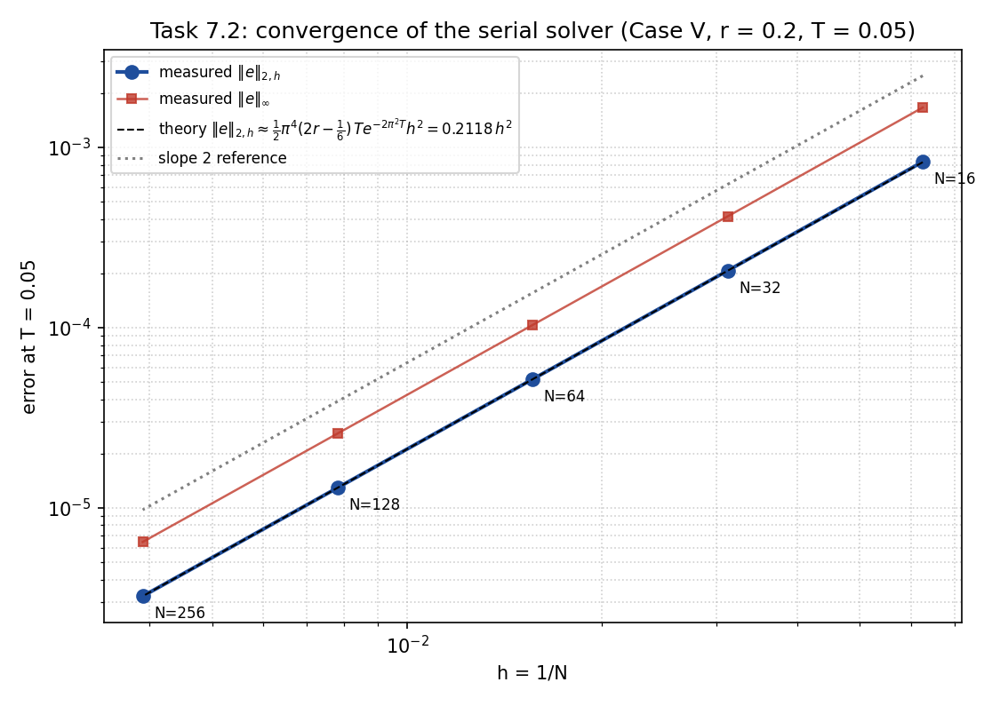

# Chapter 7 - Verification: Is My Program Right?

Reference: `heat_numerics_background.pdf`, Chapter 7, PDF pages 26-27,
printed pages 22-23.

---

## Task 7.1 - Predicting the order

From Task 5.5, the local truncation error is

$$
\tau=O(\Delta t)+O(\Delta x^2)+O(\Delta y^2).
$$

With $\Delta x=\Delta y=h$ and the dimensionless parameter
$r=\alpha\Delta t/h^2$ held **fixed** during refinement, the time step is
tied to the grid:

$$
\Delta t=\frac{r}{\alpha}h^2\quad\Longrightarrow\quad O(\Delta t)=O(h^2).
$$

Both parts are then second order in $h$:

$$
\tau=O(h^2)+O(h^2)=O(h^2).
$$

The scheme is stable for $r\le1/4$ (Chapter 6), and the problem is linear,
so by the Lax theorem (Theorem 6.2) the global error behaves like the
truncation error.

**Predicted order: $p=2$ in $h$.** Halving $h$ (doubling $N$) should divide
the error by $2^2=4$.

Note that the first-order time error does not lower the order. Halving $h$
divides $\Delta t$ by 4, so the $O(\Delta t)$ term shrinks by a factor 4,
just as the $O(h^2)$ term does.

### Predicting the error constant, not just the order

For the verification problem $u=\sin(\pi x)\sin(\pi y)e^{-2\pi^2t}$ with
$\alpha=1$, Task 5.5 gives

$$
\tau^n=K\,h^2\,u(t_n),\qquad K=\pi^4\left(2r-\tfrac16\right).
$$

Write $e^n=u_h^n-u(t_n)$. The exact solution satisfies
$u(t_{n+1})=u(t_n)+\Delta t\,\nabla_h^2u(t_n)+\Delta t\,\tau^n$. The scheme
satisfies $u_h^{n+1}=u_h^n+\Delta t\,\nabla_h^2u_h^n$. Subtracting:

$$
e^{n+1}=e^n+\Delta t\,\nabla_h^2e^n-\Delta t\,\tau^n,\qquad e^0=0 .
$$

The grid function $\phi_{i,j}=\sin(\pi x_i)\sin(\pi y_j)$ is an
eigenvector of $\nabla_h^2$, with eigenvalue $\approx-2\pi^2$. Since
$\tau^n\propto\phi$, the error stays proportional to $\phi$:
$e^n=c_n\phi$. To leading order, $c$ solves
$c'=-2\pi^2c-Kh^2e^{-2\pi^2t}$, $c(0)=0$, so

$$
c(T)=-K\,h^2\,T\,e^{-2\pi^2T}.
$$

Hence

$$
\|e\|_\infty\approx K\,T\,e^{-2\pi^2T}\,h^2,\qquad
\|e\|_{2,h}\approx\tfrac12\,K\,T\,e^{-2\pi^2T}\,h^2,
$$

because $\max\phi=1$ and
$\|\phi\|_{2,h}=h\big(\sum_{i,j}\phi_{i,j}^2\big)^{1/2}=h\cdot\frac N2=\frac12$
exactly, using $\sum_{i=1}^{N-1}\sin^2(\pi i/N)=N/2$.

For $r=0.2$ and $T=0.05$:

$$
K=\pi^4(0.4-0.16667)=22.729,\qquad e^{-2\pi^2\cdot0.05}=0.37271,
$$

$$
\boxed{\ \|e\|_\infty\approx0.42356\,h^2,\qquad \|e\|_{2,h}\approx0.21178\,h^2\ }
$$

This is a quantitative prediction made before looking at the data. Task
7.2 tests both the order and the constant.

---

## Task 7.2 - Convergence study

### (a) Runs

Verification problem of Section 1.8: $L_x=L_y=1$, $\alpha=1$, $m=n=1$,
initial condition $\sin(\pi x)\sin(\pi y)$, zero boundary values. Final
time $T=0.05$.

The dimensionless step is kept fixed at $r=0.2$, which is $\le1/4$, so
the scheme is stable. Then

$$
\Delta t=0.2\,h^2=\frac{0.2}{N^2},\qquad
\frac{T}{\Delta t}=\frac{0.05\,N^2}{0.2}=\frac{N^2}{4},
$$

which is an integer for every even $N$, as required.

The step count is passed explicitly (`--steps`), so $r$ is exactly 0.2
and the solver's reported $T$ is exactly 0.05. With `--T`, the solver
rounds the step count up with `ceil`, which could change $r$ slightly.

Command (from `scripts/background/task_7_2.py`):

```bash
./heat_serial --N <N> --r 0.2 --steps <N^2/4> --case V
```

Run on `heat-theresa` with the current `heat_serial` built by `make`.

### (b) Results

Raw solver output lines are printed by the script. The values are stored
in `results/background/task_7_2.csv`.

| N | h | $\Delta t$ | steps | $\|e\|_\infty$ | $\|e\|_{2,h}$ | $p_{obs}$ ($\infty$) | $p_{obs}$ ($2,h$) |
|---:|---:|---:|---:|---:|---:|---:|---:|
| 16 | 0.0625 | 7.8125e-04 | 64 | 1.66337e-03 | 8.31685e-04 | — | — |
| 32 | 0.03125 | 1.9531e-04 | 256 | 4.14182e-04 | 2.07091e-04 | 2.0058 | 2.0058 |
| 64 | 0.015625 | 4.8828e-05 | 1024 | 1.03442e-04 | 5.17212e-05 | 2.0014 | 2.0014 |
| 128 | 0.0078125 | 1.2207e-05 | 4096 | 2.58542e-05 | 1.29271e-05 | 2.0004 | 2.0004 |
| 256 | 0.00390625 | 3.0518e-06 | 16384 | 6.46314e-06 | 3.23157e-06 | 2.0001 | 2.0001 |

Here $p_{obs}=\log_2\big(E(h)/E(h/2)\big)$ (Section 7.3). The error
ratios are 4.0160, 4.0040, 4.0010 and 4.0002.

**Comparison with the predicted constant** (Task 7.1):

| N | measured $\|e\|_\infty$ | predicted $0.42356h^2$ | measured / predicted |
|---:|---:|---:|---:|
| 16 | 1.66337e-03 | 1.65453e-03 | 1.0053 |
| 32 | 4.14182e-04 | 4.13633e-04 | 1.0013 |
| 64 | 1.03442e-04 | 1.03408e-04 | 1.0003 |
| 128 | 2.58542e-05 | 2.58520e-05 | 1.0001 |
| 256 | 6.46314e-06 | 6.46301e-06 | 1.0000 |

The ratio $\|e\|_{2,h}/\|e\|_\infty=0.50000$ in every row, exactly the
value $\|\phi\|_{2,h}/\max\phi=1/2$ predicted for an error with the shape
of $\sin\pi x\sin\pi y$.

**Plot** of $\|e\|_{2,h}$ against $h$ on log-log axes:



File: `plots/background/task_7_2_convergence.png`, produced by
`scripts/background/task_7_2_plot.py`. The blue points are the measured
$\|e\|_{2,h}$ and the red points the measured $\|e\|_\infty$. The dashed
black line is the theoretical $0.2118h^2$. The dotted line is a slope-2
reference.

### (c) Agreement with Task 7.1

**Yes.**

- The observed order is $2.0058\to2.0014\to2.0004\to2.0001$, converging to
  the predicted $p=2$ from above. The small excess on coarse grids comes
  from the $O(h^4)$ terms neglected in Task 5.5.
- The error constant also matches the prediction from the truncation
  error analysis, to 0.5 % at $N=16$ and 0.002 % at $N=256$.
- The data lie on a straight line of slope 2 in the log-log plot.

A typical bug, such as a wrong neighbour index, a missing factor $r$ or an
in-place update, would show up as order 0 or 1, or a wrong constant.
Neither happens. **The serial solver is verified.**

Since Part 3 showed that the strips and blocks programs reproduce the
serial result (Section 7.5, "parallel equals serial"), the verification
carries over to the parallel solvers.

### Relation to the earlier convergence study

`results/convergence.csv` and `docs/PART1_SERIAL.md` §8 contain an earlier
study with $N=20,40,80,160,320$ ($p\approx2.00146$). Its run parameters
were not written down. They were identified here by re-running:

```
./heat_serial --N 20  --r 0.2 --steps 20   --case V  -> err_inf=0.000468559478489 err_l2=0.000234279739245
./heat_serial --N 320 --T 0.01 --case V              -> steps=5120 r=0.2 err_inf=1.82203920518e-06
```

Both reproduce the stored CSV values bit for bit. The earlier study
therefore used **$r=0.2$ and $T=0.01$**.

It is a valid convergence study, but not the one Task 7.2 asks for (which
uses $N=16,\dots,256$ and $T=0.05$). Both studies are kept. The earlier
files are unchanged.
